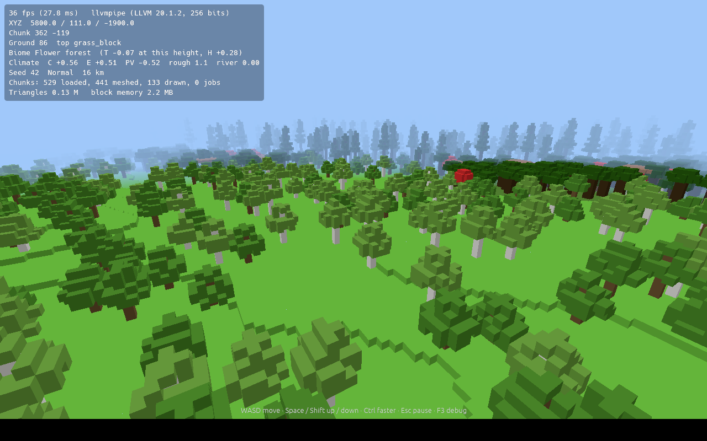

# world-gen

A Minecraft-like voxel world generator written in Rust, with a Vulkan viewer
and a game-style menu. Worlds range from **1 km to 60,000 km** across (the
full Minecraft world) and from **256 to 17,696 blocks** tall (twice Mount
Everest). They are generated on the fly from a seed, so a huge world costs
no more than a small one.

Accuracy of the generated world comes first, then performance. Visuals are
deliberately plain.



## Status

Seven steps are in: foundation, terrain (continents, oceans, mountains,
rivers), 56 biomes with trees (five kinds of beach), scale and speed (world height up to
17,696 blocks, a far view out to 256 chunks with LOD rings like Distant
Horizons, binary greedy meshing, GPU-driven drawing, an in-game world
map), a second, **realistic** generator, and a far view that can reach
the **whole world**: tick *Whole world* in Settings (or pick the Quality
preset) and fly up to see an entire planet at once. Step 7 gave planets
wilder continents (peninsulas, gulfs, inland seas, 4–8 per planet), made
grass colours fade smoothly between biomes, and turned the world map into
a satellite-style view with optional clouds.

There are two generators:

- **Classic**: a Minecraft-style world from local noise, endless and
  varied (world types Normal, Amplified, Large biomes, Islands, Flat).
- **Realistic**: a whole Earth-like planet simulated when the world is
  created: plate tectonics (ranges where plates collide, trenches, island
  arcs, mid-ocean ridges), climate from latitude, winds and rain shadows,
  and rivers that erode valleys and drain to the sea. Planets:
  Continents, Pangea, Earth (the real one, from NOAA relief data) and
  Islands, at three simulation qualities. In a 40,000 km × 17,696-block
  world, one block is one real metre.

The 60 FPS budget on an RTX 2080 is still to be confirmed on real
hardware. See [docs/PLAN.md](docs/PLAN.md) for the
roadmap and [docs/devlog/](docs/devlog/) for a detailed log of each step,
each with a short plain-language summary.

## Run it

1. Install Rust from <https://rustup.rs> (Windows: accept the Visual Studio
   C++ build tools prompt).
2. Make sure your graphics driver is up to date (any Vulkan GPU works; on
   macOS install the [Vulkan SDK](https://vulkan.lunarg.com/) for MoltenVK).
3. In this folder:

```sh
cargo run --release
```

The first build takes a few minutes. No Vulkan SDK is needed on Windows or
Linux; shaders are compiled by the build itself.

### Controls

| Key | Action |
|---|---|
| Mouse | look |
| W A S D | move |
| Space / Shift | up / down |
| Mouse wheel | fly speed ×2 (up) / ÷2 (down), 0.25 to ~1 million blocks/s |
| Ctrl | 5× speed |
| M | world map (drag, wheel to zoom, double-click to teleport) |
| Esc | pause menu |
| F3 | debug overlay |

## Maps without the game

`wg-map` draws a top-down map straight from the generator. It's the fastest
way to check what a seed looks like:

```sh
cargo run --release -p wg-map -- --seed 42 --extent 16000 --px 1024 --out map.png
cargo run --release -p wg-map -- --seed 42 --layer biome  # also: height, temperature, humidity, …
cargo run --release -p wg-map -- --seed 42 --bench 32     # generation speed (chunks and LOD tiles)
cargo run --release -p wg-map -- --seed 42 --size-km 60000 --height 17696 --extent 737000  # a tall world
cargo run --release -p wg-map -- --seed 42 --realistic earth --size-km 40000 --height 17696 --whole --px 1200
cargo run --release -p wg-map -- --seed 42 --realistic continents --quality quality --whole  # planets: continents|pangea|earth|islands
cargo run --release -p worldgen --example planet_stats -- 42 continents   # climate and aridity statistics
```

## Layout

| Crate | Purpose |
|---|---|
| `crates/worldgen` | the generators: noise, chunks, settings, terrain, biomes, trees, and `realistic/` (tectonics, climate, erosion, Earth data). No graphics. |
| `crates/wg-map` | map and benchmark tool |
| `crates/game` | window, menus, world map, Vulkan renderer (GPU-driven), binary greedy mesher, LOD quadtree, chunk and tile streaming |

## Tests

```sh
cargo test
```
