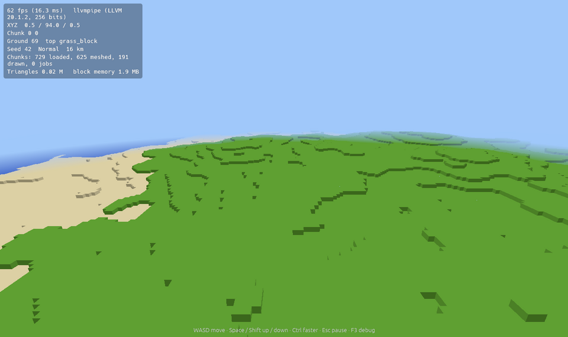
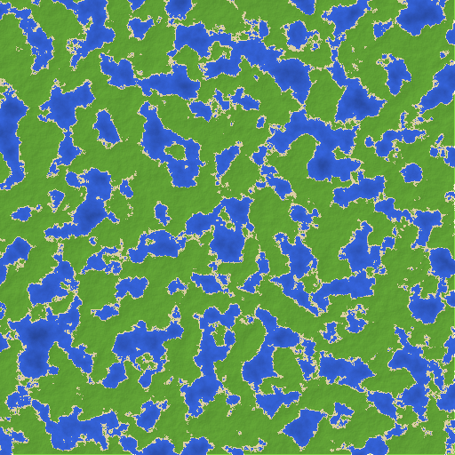
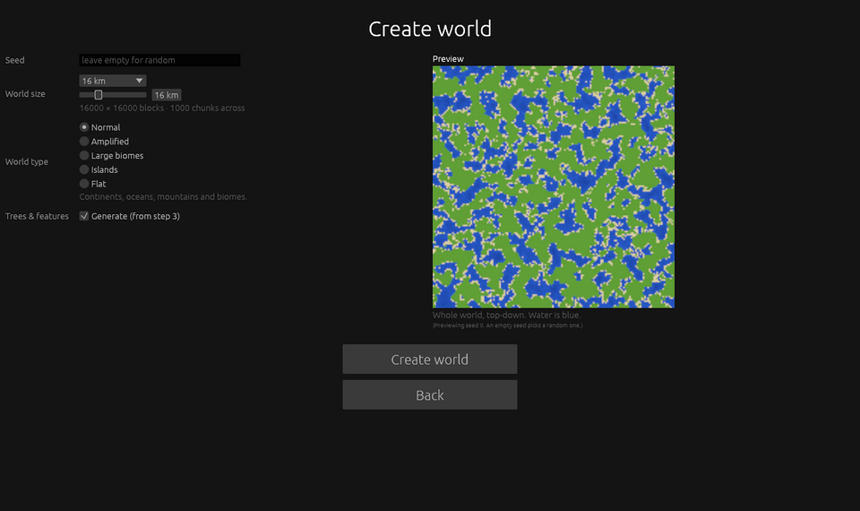

# Devlog 01: Foundation



## In plain words (no coding knowledge needed)

**What we built:** the skeleton of the whole program. You can open it, use a
menu, choose a seed, a world size (from 1 km up to 60,000 km) and a world
type, see a small map of the world before you enter it, and then fly over
the generated land.

**The big idea:** the world is *never saved*. It works like a recipe: given
the same seed (a number), the program always "cooks" exactly the same
landscape, one small piece at a time, only around you. That is why a world
as large as Minecraft's costs no more memory than a tiny one.

**How the land is made:** a mathematical "random but smooth" pattern called
*Perlin noise* (the same tool used in films and most terrain games) decides
how high the ground is at each spot. Layers of it at different sizes give
both big shapes and small bumps. Below sea level it fills with water; near
the water it becomes sand; very high up it turns to rock and snow.

**How it stays fast:**
- The world is cut into *chunks* (16 × 16 blocks wide, 384 tall). Only nearby
  chunks exist at any moment, and they are built on all your CPU cores at
  once.
- Each chunk is stored in a compressed way: instead of writing "grass, grass,
  grass…" thousands of times, it keeps a short list of the block types it
  uses and tiny numbers pointing into that list. A chunk shrinks from
  192 KB to about 2.5 KB.
- When drawing, hidden faces (between two blocks touching each other) are
  thrown away, and flat areas of the same block are merged into big
  rectangles. A flat field of 256 grass tops becomes 1 shape.

**What it looks like right now:** gentle hills, lakes and beaches. That's on
purpose: this step was about the machinery. Step 2 replaces the simple hills
with real continents, oceans and mountains.

**Checked by:** 44 automatic tests (for example "same seed gives the same
world", "nothing exists outside the world border", "the far edge of a
60,000 km world has normal terrain"), plus running the game on a software
graphics card with Vulkan's official error checker switched on: zero errors.

---

## Technical log

### Workspace

```
crates/worldgen   1,560 lines  pure generator library (no GPU, no I/O)
crates/wg-map       165 lines  map renderer + benchmark CLI
crates/game       2,761 lines  winit + egui + ash renderer, mesher, streaming
```

`worldgen` has no graphics dependencies so it can be tested headless, reused
by tools, and later by a server. `[profile.dev.package."*"] opt-level = 2`
keeps `cargo run` without `--release` usable, because world generation is
CPU heavy.

### Deterministic randomness: `worldgen::rng`

`rand` makes no stability promise across versions, and world generation must
be bit-identical forever, so the crate ships its own:

| Function | Algorithm | Used for |
|---|---|---|
| `SplitMix64`, `mix64` | Vigna's SplitMix64 | expanding seeds, hashing |
| `Xoroshiro128PlusPlus` | Blackman & Vigna 2019 | permutation tables |
| `derive_seed(seed, "salt")` | FNV-1a(salt) ⊕ seed → mix64 | one independent stream per feature |
| `hash_position(seed, x, y, z)` | 3 rounds of mix64 | stateless per-block randomness |

`derive_seed` matters long-term: every feature (`"terrain/height"`,
`"surface/bedrock"`, later `"trees/oak"`) has its own stream, so adding a
feature never shifts the random numbers of existing ones. Without that, adding
trees would also move every mountain.

`hash_position` is what makes generation order-independent: chunk (5, 7)
asks "random value at block (83, 12, 120)?" directly, without having to
generate chunks 0..4 first. The SplitMix reference values in the tests were
checked against Vigna's C implementation.

### Noise: `worldgen::noise`

- **`ImprovedPerlin`**: Perlin's 2002 Improved Noise. 256-entry permutation
  table shuffled with Fisher–Yates from Xoroshiro, quintic fade
  `6t⁵ − 15t⁴ + 10t³` (C² continuous, no grid creases), 12 edge gradients.
  Each instance also gets a random sub-block origin, because Perlin noise is
  exactly 0 on integer lattice points and would otherwise line up across
  octaves.
- **`OctaveNoise`** (fBm): octave *i* has frequency `2^(first_octave + i)`,
  persistence 0.5 and a per-octave amplitude multiplier (0 skips the octave).
  The sum is normalised to roughly [-1, 1].
- **`DoubleNoise`**: two independent `OctaveNoise` fields, the second sampled
  at ×1.0181… scale, averaged and rescaled by √2. This cancels the faint
  axis-aligned structure of a single Perlin field and gives a more
  bell-shaped value distribution. It's meant for the large-scale climate
  parameters in step 2.
- **Precision at the world border.** Inputs are wrapped into ±2²⁵ with
  `wrap()` before sampling. Perlin only uses `floor(x) & 255` and the
  fractional part, so wrapping by a multiple of 256 changes nothing, but it
  keeps `f64` precision perfect at x = 30,000,000 even for high-frequency
  octaves. Test `detail_is_preserved_far_from_origin` samples 64 adjacent
  blocks at x ≈ 29,999,000 and requires more than 60 distinct values (no
  stair-stepping). This is the class of bug behind Minecraft's historic "Far
  Lands".

### Blocks and storage

- `BlockId(u16)` indexes a static table (`name`, flat sRGB `color`,
  `Opacity::{Empty, Opaque, Translucent}`). 14 blocks so far. The `blocks!`
  macro generates constants and the table together; a test enforces dense
  ids.
- **`PalettedSection`** (16³ = 4096 blocks): palette `Vec<BlockId>` plus
  bit-packed indices in `u64` words with `bits = ceil(log2(palette_len))`.
  Entries never straddle words, so a read is one divide, one shift and one
  mask. A uniform section (all air, all stone) has `bits = 0` and no data at
  all. `set` grows the bit width on demand (`repack`). `from_dense` builds a
  section from a plain array in one pass with a 64-entry lookup table, which
  is how the generator writes (fill dense array, then compress).
- **`Chunk`**: 24 sections (y = −64..319) plus a 16×16 `i16` heightmap.
  `ChunkPos::from_block` uses arithmetic shift, so negative coordinates map
  correctly (block −1 → chunk −1).

Measured with `wg-map --bench 32` (seed 42, 1,024 chunks, one thread):
**0.25 ms per chunk**, **2.5 KiB per chunk** stored. A dense `u16` array
would be 192 KiB, so palettes give about a 77× reduction.

### World settings

`WorldSettings { seed, size, world_type, features }`, serde-serialisable
(RON). `WorldSize` is clamped to [1,000 … 59,999,968] blocks, centred on 0,0.
`contains_column` is the single source of truth for the border, and tests
cover both edges of a 1 km and a full-size world. Seeds typed as text are
parsed as `i64`/`u64`, or hashed if they're words, so `"hello"` is a stable
seed.

World types (step 1 behaviour, re-done properly in step 2):
Normal, Amplified (×2.4 relief), Large biomes (×4 horizontal scale), Islands
(terrain shifted below sea level so only peaks emerge), Flat (bedrock, 2 dirt, grass at y = −61).

### Generator

`WorldGenerator` is immutable, `Send + Sync`, and a pure function of
`(settings, ChunkPos)`.

- `sample_column(x, z)` → `{ surface_y, top_block, underwater, inside }`
  without building a chunk. Used by `generate_chunk`, `wg-map`, the menu
  preview and the HUD. Test `column_sample_matches_generated_chunk`
  guarantees maps show exactly what's in the world.
- Step 1 height: 8-octave fBm with 1 km base features plus a 3-octave detail
  layer. Placeholder only.
- Surface: beaches within 2 blocks of sea level, sand/gravel/clay sea floor
  by depth, bare stone above y = 165, snow above y = 200, 3–5 blocks of
  filler (per-column hash), sandstone under sand, ragged bedrock floor
  (y = −64 solid, then probability 4/5 … 1/5).
- `find_spawn()` walks an outward spiral (step 8) for dry land below y = 160.

### Map tool (`wg-map`)

Renders `sample_column` in parallel with rayon. Water is shaded by depth,
land is hill-shaded by the slope towards the south-east neighbour. 590k
columns take about 140 ms. `--bench N` times single-thread generation of an
N×N chunk square.



*Seed 42, Normal, central 16 km. This is step 1's placeholder terrain:
lakes and gentle hills only. Step 2 will produce continents.*

### Game

**Menus (egui 0.36).** Main menu (Play, Settings, Quit). The Create world
screen has the seed, a size preset list plus a logarithmic 1–60,000 km
slider, the world type, a features toggle and a **live 160×160 preview map**
drawn by the real generator (the whole world for ≤ 16 km, otherwise the
central 16 km). Then Settings (render distance 2–32, FOV, mouse sensitivity,
fly speed, vsync, debug overlay), saved to `settings.ron`, and a pause menu
on Esc. The debug overlay (F3) shows FPS, position, chunk, ground height and
block, seed/type/size, chunk counts, triangles and block memory.



**Streaming (`world.rs`).** `ChunkManager` owns a rayon pool with
`cores − 1` threads. Each frame it collects finished jobs from an mpsc
channel, unloads chunks beyond the radius + 2 (hysteresis), and schedules new
work nearest-first from a precomputed spiral of offsets, capped at
3 × threads jobs in flight. Generation runs one ring wider than meshing,
because meshing a chunk needs its 4 neighbours. Chunks outside the world
border count as "known air", so edge chunks still mesh. Tests check that
every chunk in range is meshed exactly once and that nothing beyond the
border is generated.

**Mesher (`mesh.rs`).** For each non-empty section a padded 18³ block cache
is filled (section + 1-block border from neighbour sections/chunks). Then,
for each of 6 directions × 16 slices, a 16×16 visibility mask is built and
greedy-merged (Lysenko 2012): grow a run along *u*, then grow rows along
*v* while the whole run matches, emit one quad, clear. Visibility rules:
opaque faces show against non-opaque neighbours, while translucent blocks
(water, leaves, ice) show only against air, so lakes have no internal faces.
The world's underside is never drawn. Fully opaque sections enclosed by
opaque sections are skipped in O(1) using the palette's `uniform()`.
Axes are chosen cyclically (`u = d+1, v = d+2`) so `u × v = +d`, which fixes
the triangle winding with no special cases. Vertices are 16 bytes
(`[f32; 3]` + `[u8; 4]` sRGB colour with per-face shade baked in).
On real terrain a chunk of 98,304 blocks becomes a few hundred quads.

**Renderer (`render/`, ash 0.38 + gpu-allocator).**
- Instance: Vulkan 1.1, surface extensions from `ash-window`, portability
  enumeration when present (MoltenVK on macOS), optional Khronos validation
  (`WG_VALIDATION=1`). Device: prefers a discrete GPU with graphics + present
  on one queue; `VK_KHR_portability_subset` when exposed.
- Swapchain: sRGB format when available, FIFO (vsync) or MAILBOX/IMMEDIATE,
  D32 depth (falls back to X8D24 or D16), one render-finished semaphore per
  swapchain image (avoids the semaphore-reuse hazard), recreated on resize
  or vsync change.
- 2 frames in flight with per-frame fences. Chunk meshes are uploaded via a
  host-visible staging buffer into **device-local** vertex/index buffers,
  recorded at the start of the frame's command buffer, with a
  transfer→vertex-input barrier and a cap of 48 uploads per frame. Buffers
  that are replaced or unloaded go onto a per-frame garbage list and are
  freed only after that frame's fence signals.
- **Camera-relative rendering.** The camera position is `f64`. Per chunk,
  `(chunk origin − camera)` is computed in `f64`, converted to `f32` and
  passed as a push constant. The view matrix has no translation. The GPU
  never sees large numbers, so there is no vertex jitter at 30,000 km.
- Frustum culling per chunk AABB (Gribb–Hartmann planes) and distance fog
  over the last 30% of the view distance.
- Shaders: Vulkan GLSL compiled to SPIR-V by naga in `build.rs`, so no
  Vulkan SDK is needed to build. Bug found and fixed while testing: naga's
  SPIR-V writer flips `gl_Position.y` by default (wgpu's convention), which
  rendered the world upside down with inverted culling. The flag
  `ADJUST_COORDINATE_SPACE` is now disabled, and a unit test pins down the
  projection's Y orientation.
- egui is drawn in the same render pass with `egui-ash-renderer`.

### Verification

- `cargo test`: **44 tests pass** (31 in `worldgen`, 13 in `game`).
- `cargo clippy --all-targets`: clean.
- Ran the release build on Mesa lavapipe (software Vulkan) under Xvfb with
  the Khronos validation layer: **no validation errors or warnings**. Main
  menu, Create world and in-game screens were checked with screenshots. On
  this CPU-only renderer with 4 cores it held **about 60–90 FPS** with
  625 chunks meshed (render distance 12). A real GPU will be far faster;
  measuring on an RTX 2080/3060 is still to do.

### Known limitations (addressed later)

- Terrain is a placeholder heightmap: no continents, mountains or overhangs
  (step 2).
- No biomes or trees; the "features" toggle is stored but unused (step 3).
- Nothing beyond the render distance; no LOD (step 4).
- One draw call per chunk; fine at 32-chunk radius, replaced by indirect
  drawing in step 4.
