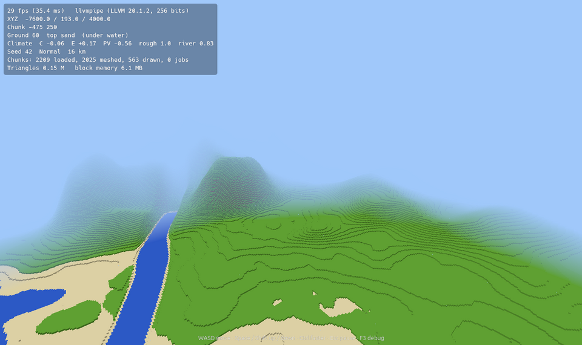
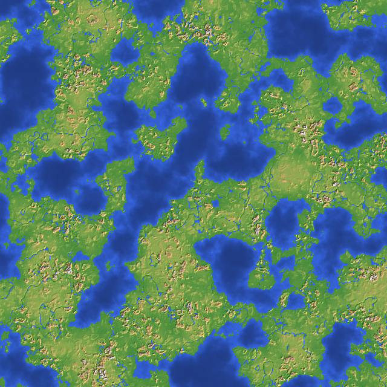
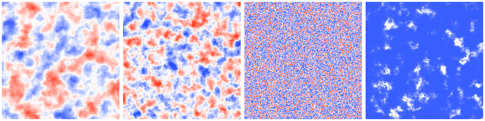
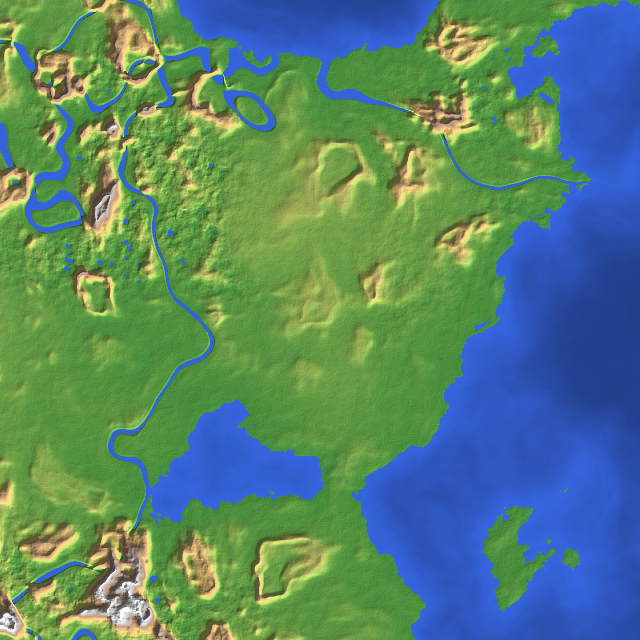
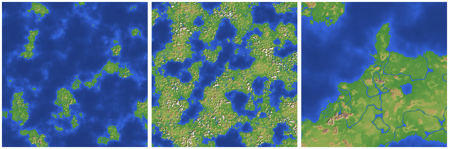

# Devlog 02: Terrain



## In plain words (no coding knowledge needed)

**What changed:** the world now has real geography. There are continents
several kilometres across, deep oceans, shallow coastal shelves, beaches,
plains, hills, mountain ranges with snowy peaks, rivers that wind across the
land into the sea, and cliffs and overhangs in the mountains.

**How it works:** the program paints a few invisible "maps" over the whole
world, each made of smooth random noise:

- a **land map** ("continentalness"): low means deep ocean, high means far
  inland;
- a **ruggedness map** ("erosion"): low means mountains, high means flat,
  worn-down land;
- a **ridge map** ("peaks and valleys"): where ridges and valleys run;
- a **river map**: rivers follow the lines where this map crosses zero.

Then a set of hand-tuned curves turns those values into a height. For
example, "a land value of −0.19 means 14 blocks below sea level, the edge of
the continental shelf." Changing the look of the world is now a matter of
editing these tables, not rewriting code.

On top of the height, a 3D noise is added. It barely does anything in the
lowlands, but in mountains it is strong enough to cut cliffs, ledges and
overhangs, which a plain height map can't do.

**How we know it's right:** 53 automatic tests (13 more than step 1). New ones check, over a
40 × 40 km area and several seeds:
- the land/ocean split stays between 40% and 80%;
- deep oceans exist;
- mountains above y = 170 exist but stay rare;
- the Islands type is mostly ocean;
- Amplified is taller than Normal;
- rugged areas really contain overhangs;
- the far edge of a 60,000 km world has smooth, normal terrain.

The map tool can now also draw each invisible map, so we can see why a
place looks the way it does.



---

## Technical log

### New modules

| File | Purpose |
|---|---|
| `worldgen/src/spline.rs` | `Curve`: monotone cubic Hermite spline (Fritsch–Carlson), plus `smoothstep`/`lerp` |
| `worldgen/src/terrain.rs` | `TerrainShaper`: climate noise → `Shape { climate, height, roughness, river }` |
| `worldgen/src/generator.rs` | rewritten: 3D density, interpolation grid, surface rules |
| `worldgen/examples/noise_stats.rs` | prints climate-noise percentiles, used to calibrate gains |

### Climate parameters

All are `DoubleNoise` sampled in 2D at a domain-warped position
(`x + 300 · warp_x(x, z)`, same for z, warp noise at 1 km scale). Each is
multiplied by a gain chosen so its 1st/99th percentiles sit near ±0.9, then
clamped to [−1, 1]:

| Parameter | Lowest octave | Octaves | Raw p99 | Gain |
|---|---|---|---|---|
| continentalness | 2⁻¹² (4 km) | 9 | 0.365 | 2.45 |
| erosion | 2⁻¹¹ (2 km) | 5 | 0.377 | 2.4 |
| weirdness | 2⁻⁹ (512 m) | 4 | 0.392 | 2.3 |
| river | 2⁻¹¹ (2 km) | 4 | 0.388 | 2.3 |

(The distributions were measured over 200,000 samples with
`cargo run --release -p worldgen --example noise_stats`.)

Peaks & valleys is weirdness folded: `pv = 1 − |3|w| − 2|`, so both signs of
weirdness give ridges and |w| ≈ 0 gives valleys.

**First attempt and why it changed.** My first scales (continentalness
lowest octave 1 km, with weight on the 128–256 m octaves) produced land and
sea patches about 1 km across, a "noisy archipelago". Moving everything 2–4× larger and using flat octave weights
gave continents several km wide with detailed coasts. Valleys also dropped
below sea level inland and scattered hundreds of ponds through mountain
areas. The valley ends of `ridge_height` and `hill_height` were raised to fix
that.

### Shaping (`TerrainShaper::shape`)

```
inland     = Curve_inland(c)                      0 at sea → 1 inland
mtn        = Curve_mountain(e) · inland           0 flat … 1 mountainous
relief     = mtn · Curve_ridge(pv) + (1 − mtn) · inland · Curve_hill(pv)
relief    += mtn · smoothstep(0.35, 0.9, pv) · |jagged(x, z)| · 45     summits
height     = SEA_LEVEL + Curve_base(c) + relief
roughness  = Curve_rough(mtn)                     1 … 13 blocks of 3D noise
```

Base height by continentalness (blocks relative to sea level):

| c | −1 | −0.55 | −0.32 | −0.19 | −0.11 | −0.06 | 0 | 0.25 | 0.55 | 1 |
|---|---|---|---|---|---|---|---|---|---|---|
| height | −48 | −42 | −30 | −14 | −4 | +1.5 | +4 | +12 | +24 | +34 |

Ridge height by peaks & valleys (scaled by `mtn`): −5 at pv = −1, 0, +10,
+36, +95, +150, up to +170 at pv = 1.

Monotone splines matter here: an ordinary Catmull-Rom curve overshoots
between steep points, which would put a "coast" point above sea level or a
deep-ocean point above the shelf. The `Curve` tests check monotonicity and
the absence of overshoot.

**World types** now act through the same model:
- *Amplified*: positive relief ×2.2, negative ×1.4, roughness ×1.6.
- *Islands*: `c' = 0.8c − 0.42`, so only the highest continentalness
  breaks the surface.
- *Large biomes*: all climate coordinates ÷4.
- *Flat*: unchanged.

### Rivers

`r = |river(x, z)| · gain`. The channel is `1 − smoothstep(0.008, 0.03, r)`,
and a wider valley is `1 − smoothstep(0.02, 0.1, r)`. Rivers are allowed
only where `c > −0.16` and fade out over 30–70 blocks above sea level, so
they don't slice through mountains. The valley lowers the terrain towards
`SEA_LEVEL + 1 + 0.35·(height − sea)`. The channel then carves to
`SEA_LEVEL − 3`, so it fills with water at sea level, and roughness is
forced to 1 in the valley so the banks are smooth. Because the zero line of
the noise continues into the ocean, rivers reach the sea naturally.

Known limitation: rivers are at sea level everywhere. They can't flow
downhill from a high plateau; they fade out there instead. Rivers with real
gradients need erosion simulation or a drainage graph. That's a candidate
for later, not in the current roadmap.

### 3D density

```
solid(x, y, z)  ⇔  (H − y) + A · N(x, y, z) > 0
```

- `N`: 4-octave Improved Perlin fBm, 64 → 8 block features, ×2.5 gain, so
  `|N| ≤ 2.7`.
- **Noise band:** every block above `H + 2.7A` is air and every block below
  `H − 2.7A` is solid, with no noise evaluation needed. In the lowlands
  (A ≈ 1) only about 6 blocks per column touch the noise.
- **Interpolation grid:** `N` is evaluated at the corners of 4×8×4-block
  cells aligned to world coordinates, and trilinearly interpolated per
  block. A chunk needs at most 5 × 49 × 5 corners, and only the grid layers
  inside the chunk's union of bands are filled.
- **Exactness:** `sample_column` uses the *same* `corner()` and `solid()`
  functions as `generate_chunk`, so the column scan and the chunk agree
  bit for bit. The test `column_sample_matches_generated_chunk` now runs 4
  chunks × all 5 world types and checks the top block, that nothing solid
  is above the surface, the bedrock, and the heightmap.
- `H` is clamped to `[MIN_Y + 8 + 2.7A, MAX_Y − 2 − 2.7A]` so the band never
  leaves the world.

### Surface rules

Each solid block whose upper neighbour is air or water starts a new
"surface" (the top of the world, or the floor under an overhang), and the
following blocks count depth from it:

| Situation | Top | Filler (3–5 blocks) |
|---|---|---|
| below sea level − 1, depth < 7, or a river bed | sand | sand, then sandstone |
| below sea level − 1, deeper | gravel (clay 1 in 8) | gravel |
| ≤ sea + 1 on the coast (c < −0.03) or a river bank | sand | sand, then sandstone |
| ≥ 195 ± 4 | snow | stone |
| ≥ 160 ± 4, or roughness > 9 above 120 ± 4 | stone | stone |
| otherwise | grass | dirt |

The ±4 is a per-column hash, so the snow line and tree line are ragged
instead of a flat contour. Step 3 replaces this table with per-biome rules.

### Map tool

`--layer surface|height|continentalness|erosion|pv|roughness`. `height` uses
a hypsometric tint (green → tan → brown → grey → white) with hill shading.
Parameter layers use a blue–white–red ramp. Every run also prints surface
height percentiles.

Climate layers for seed 42, 24 km. From left: continentalness, erosion,
peaks & valleys, roughness. Blue is low, red is high.



The 4 km zoom shows a meandering river, a bay, a coastal plain and a
mountain block with snow:



The world types Islands, Amplified and Large biomes (same seed, 24 km):



### Measurements

Over 40 × 40 km, 400 × 400 samples each:

| Type | Seed | Land | p10 | p50 | p90 | p99 | max |
|---|---|---|---|---|---|---|---|
| Normal | 1 | 57.6% | 22 | 67 | 92 | 158 | 270 |
| Normal | 2 | 59.6% | 23 | 67 | 92 | 166 | 265 |
| Normal | 3 | 58.7% | 26 | 66 | 91 | 162 | 276 |
| Amplified | 1 | 57.8% | 22 | 67 | 104 | 253 | 299 |
| Large biomes | 1 | 51.9% | 20 | 64 | 92 | 149 | 261 |
| Large biomes | 2 | 69.8% | 39 | 70 | 92 | 177 | 267 |
| Islands | 1 | 14.6% | 16 | 27 | 67 | 88 | 234 |
| Islands | 2 | 12.9% | 16 | 27 | 65 | 91 | 248 |

Normal is consistent across seeds at about 58% land. Large biomes varies
more between seeds, as expected, because 40 km holds only a few of its
continents. Ocean floors bottom out at y ≈ 13 (sea level − 50).

Performance (`wg-map --bench 32`, one thread): **0.71 ms per chunk**, up from
0.25 ms in step 1 (more noise layers plus the 3D band), and **3.0 KiB per
chunk** stored. With the 3 worker threads on the 4-core test machine,
chunks generate faster than the renderer uploads them (48 per frame).
Sampling a column for maps costs about 7 µs.

In game, on the lavapipe software renderer with the Vulkan validation layer
on: no errors. 29 FPS at render distance 22 (2,025 meshed chunks), and the
screenshot above is from that run.

### Also in this step

- HUD line: `Climate C E PV rough river` for the column under the camera.
- Create-world preview map is computed in parallel (rayon).
- `WG_CAMERA=x,z[,yaw,pitch,height]` places the camera for screenshots.

### Next

Step 3 picks biomes from these same parameters plus temperature and
humidity, so a "stony peaks" biome will automatically sit on the high
ridges, and swamps on low, flat, wet land. It then adds per-biome surface
rules and trees.
