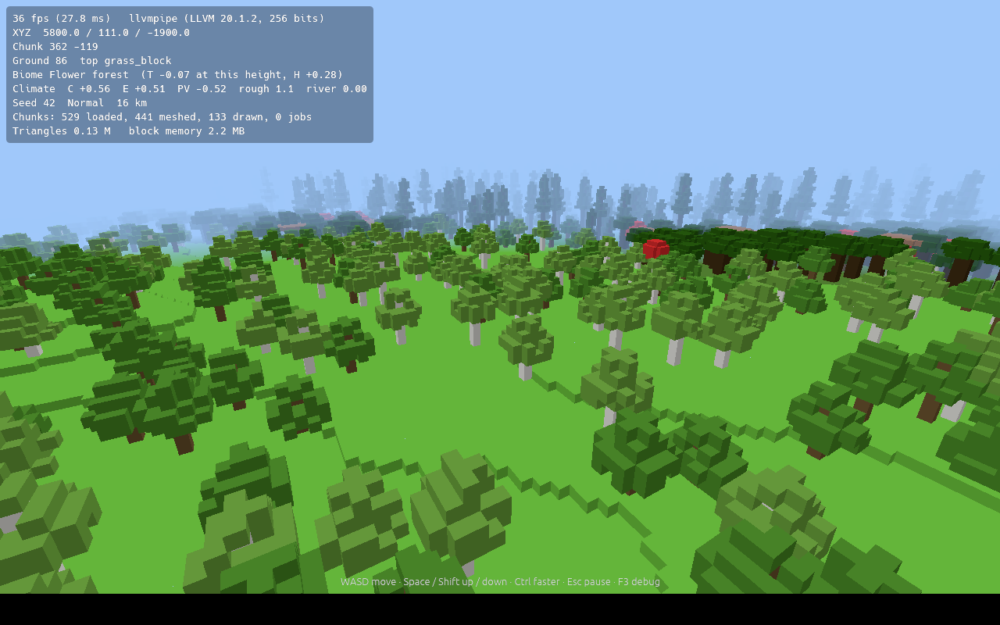
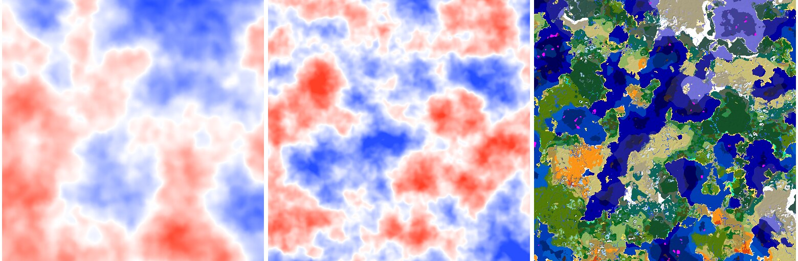
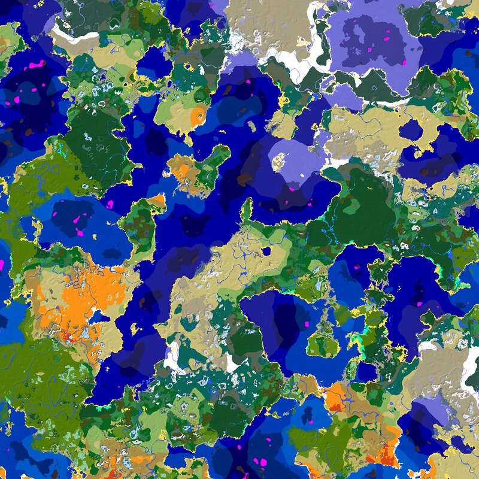
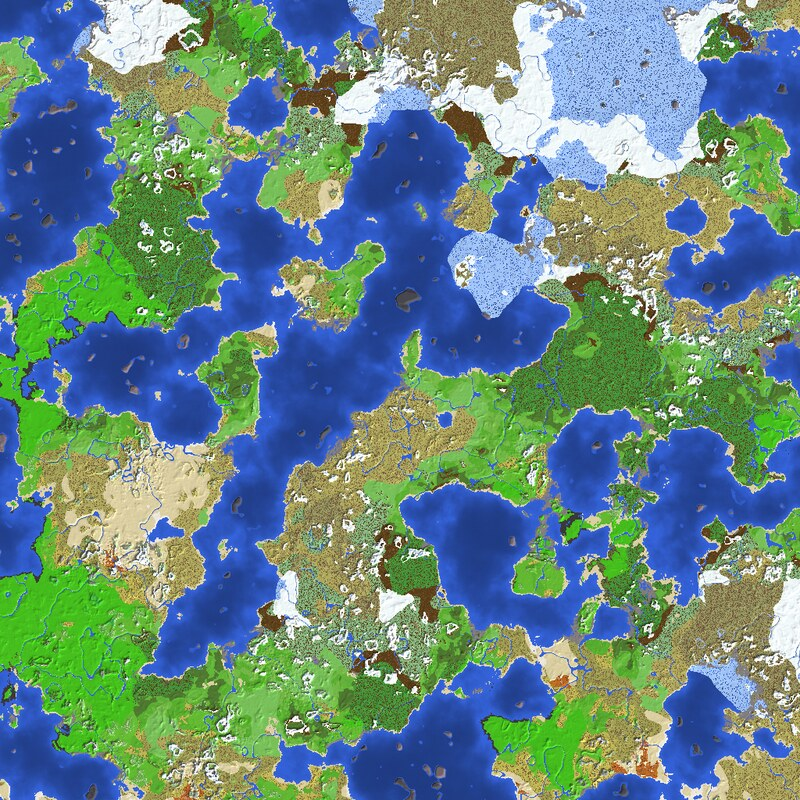
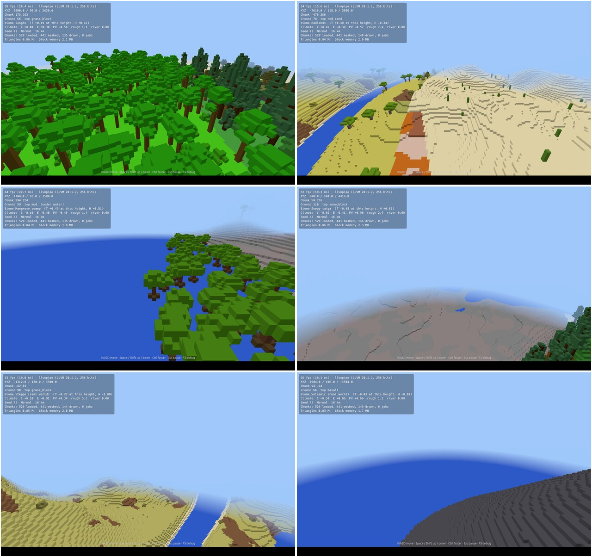

# Devlog 03: Biomes and trees

## In plain words (no coding knowledge needed)

**What changed:** the world now has 48 kinds of landscape, called
"biomes", and trees. There are deserts, jungles, snowy forests, swamps,
savannas, red badlands with striped cliffs, frozen seas with ice, beaches,
mangroves standing in shallow water, and snowy mountain peaks. There are
also landscapes from the real world that Minecraft doesn't have: tundra,
steppe, salt flats, fjords, chaparral (dry Mediterranean scrub), karst,
temperate rainforest, cloud forest, lakes, and small volcanic islands in
the open ocean.

**How it works:** step 2 painted invisible maps for land, ruggedness and
ridges. Step 3 adds two more: a **temperature map** and a **rainfall
map**. Each place then picks its biome with simple rules that follow real
geography:

- under water → an ocean (frozen, cold, normal, lukewarm or warm, deep or
  shallow), a river or a lake;
- low land by the sea → a beach (or a snowy beach, a mangrove, salt flats,
  a stony shore or a fjord);
- high up → colder. The air cools as you climb, just like on Earth, so
  tall mountains get snowy peaks even in warm regions;
- everywhere else → the classic ecology chart of temperature against
  rainfall: cold and dry is tundra, hot and dry is desert, hot and wet is
  jungle, mild and wet is forest, and so on.

Each biome has its own ground: sand in deserts, snow in the north, red sand
and coloured clay stripes in the badlands, mud in mangroves, black volcanic
rock on the islands. Grass changes colour too, from lush green in jungles
to olive in swamps and straw-yellow in savannas.

**Trees** come in 9 shapes: oak, birch, spruce (normal and giant), jungle,
acacia, dark oak, mangrove, cactus and giant mushrooms, plus small bushes.
They are spread out evenly, like trees in a real forest, rather than in
random clumps. A tree on the edge of one chunk still has its full crown
in the next one, with no cut-off seams.

**How we know it's right:** 67 automatic tests (14 more than step 2, 2 of them for the mouse-wheel speed). New
ones check, over 48 × 48 km and two seeds:
- every one of the 48 biomes actually appears;
- ocean biomes are only under water, and land biomes only on land;
- deserts and jungles are never in cold places, and snowy biomes never in
  warm ones;
- peaks are only on high mountains, and beaches only at sea level;
- trees are seamless across chunk borders;
- forests have many trees, and deserts have very few;
- with the "Trees" option off there are no trees at all.

---

## Technical log

### New and changed modules

| File | Purpose |
|---|---|
| `worldgen/src/biome.rs` | `Biome` enum (48, one byte), colours, `select(shape, surface_y)`, lapse rate |
| `worldgen/src/trees.rs` | jittered-grid candidates, per-biome density and species, tree shapes |
| `worldgen/src/terrain.rs` | + temperature, humidity and island noise; `Shape.island` |
| `worldgen/src/generator.rs` | per-biome surface rules, sea ice, tree pass, `trees_for_chunk` |
| `worldgen/src/block.rs` | 32 new blocks (ground and tree blocks), `is_leaves`, `is_tree_part` |
| `worldgen/src/chunk.rs` | `biomes: [Biome; 256]` per chunk |
| `worldgen/examples/find_biome.rs` | nearest column of a biome, for screenshots |
| `game/src/mesh.rs` | grass and oak leaves tinted by biome |
| `wg-map` | `--layer biome|temperature|humidity`, `--no-trees`, biome area shares |

### Climate

Two new `DoubleNoise` parameters, sampled at the same domain-warped position
as the others. Neither changes the terrain shape.

| Parameter | Lowest octave | Octaves | Gain |
|---|---|---|---|
| temperature | 2⁻¹³ (8 km) | 4 | 2.3 |
| humidity | 2⁻¹² (4 km) | 4 | 2.3 |
| islands | 2⁻⁹ (512 m) | 2 | 1.9 |

**First attempt and why it changed.** I first used 2 km for both, the
same scale as erosion. On the map, frozen oceans sat 1 km away from
jungles. Temperature now changes four times more slowly than that, and
humidity twice as slowly. That gives coherent climate zones (an arctic
north and a tropical south across 24 km), with several biomes inside each
zone.

**Altitude cooling (lapse rate).** The biome code uses
`t_eff = t − max(0, alt − 15) / 160`. A summit 125 blocks above its valley
is 0.7 colder, which turns a temperate climate into a frozen one. That is
why peaks are snowy everywhere except in the hottest regions, where they
are bare stone (`stony_peaks`).

**Oceanic islands.** Where continentalness is below −0.3 (deep ocean),
`island = smoothstep(0.62, 0.95, v)`, with `v` the island noise. That
raises the height to at least `SEA − 14 + 85·island`, a cone up to ~70
blocks above the sea with smooth flanks. The islands are wet (mushroom
fields) or dry (volcanic: basalt, with black basalt sand on the sea floor
around them). This changes terrain only in deep ocean. Every step-2
statistics test still passes unchanged.

### Biome selection (`biome::select`)

The selection is a decision tree on (continentalness, erosion, weirdness,
peaks & valleys, temperature, humidity, surface height, river, island):

1. **Under water** (`surface_y < SEA_LEVEL`): river (`river > 0.3`, frozen
   below t = −0.45), mangrove (hot, wet, ≤ 4 deep near the coast), lake
   (`c > 0.05`, inland), otherwise ocean. The ocean variant is
   deep/shallow (`c < −0.45`) × 5 temperature bands.
2. **Island** → mushroom fields (humidity > 0) or volcanic.
3. **Coast**: rugged (`e < −0.3`) and ≤ 14 above the sea → fjord (cold) or
   stony shore. Otherwise, at `c < −0.03` and ≤ 3 above the sea → snowy
   beach (frozen), mangrove (hot and wet), salt flats (warm and arid: a
   coastal sabkha) or beach.
4. **Peaks**: more than 125 above the sea, or more than 85 on a ridge
   (`pv > 0.5`, `e < −0.2`) → jagged peaks or frozen peaks (cold, split by
   the sign of weirdness), or stony peaks.
5. **Slopes**, more than 55 above the sea: grove or snowy slopes (cold),
   cloud forest (warm and wet), windswept hills (dry and rough), meadow
   (temperate). Anything else falls through to step 6.
6. **Whittaker grid**, 5 temperature bands × 5 humidity bands. The cut
   points at ±0.1 and ±0.33 split humidity into equal fifths:

| | arid | dry | medium | wet | very wet |
|---|---|---|---|---|---|
| **frozen** | tundra | tundra | snowy plains | snowy taiga | snowy taiga |
| **cold** | steppe | taiga | taiga | old-growth taiga | temperate rainforest |
| **temperate** | steppe | plains | forest / birch forest | dark forest / flower forest | swamp (flat, low) or temperate rainforest |
| **warm** | desert | chaparral | savanna / forest | karst (hilly) or sparse jungle | swamp or jungle |
| **hot** | badlands (rugged) or desert | savanna | savanna / sparse jungle | jungle | jungle |

"A / B" is split by the sign of weirdness, so sister biomes form natural
patches. Weirdness is already a smooth noise, and its sign changes along
valley lines.

The biome depends on the *final* surface height, after the 3D noise. Both
`generate_chunk` and `sample_column` find that surface with the same
`solid()` function, so they agree. The chunk decides the biome at the
first solid block of each column and reuses it for surfaces under
overhangs.

### Surface rules

`surface_for(x, y, z, shape, biome) → (top, filler)`, in this order:

| Situation | Top / filler |
|---|---|
| sea/lake/river bed | sand (shallow, river, warm ocean), gravel/clay deeper; mud in mangroves; basalt around volcanic islands |
| shoreline (≤ sea + 1 at the coast or a river) | sand; snow on sand (snowy beach); stone/gravel (stony shore, fjord); mud; salt; basalt; mycelium |
| y ≥ 200 ± 4 | snow / stone |
| by biome | snow (snowy biomes, peaks; packed ice patches on frozen peaks), podzol (taiga), red sand (badlands), salt, sand (desert), coarse dirt patches (savanna, steppe, chaparral, tundra), mycelium, basalt, limestone (karst), mud patches (swamp), grass/dirt |
| soil above y ≈ 160, or on crags above 120 | stone |

Patches (podzol in taiga, coarse dirt in savanna, gravel on stony shores,
holes in sea ice) come from a 2-octave noise with ~16-block blobs, not
per-block random, so they look like patches and not static.

Below the filler, badlands use 40 blocks of **terracotta stripes**. A
32-entry band table is shuffled per seed, mostly plain terracotta with
1–3-block orange, yellow, red, white and brown stripes. The stripes wobble
±6 blocks over ~64 blocks, so canyon walls show bent strata. Karst bedrock
is limestone, and volcanic islands have 12 blocks of basalt.

**Sea ice** covers sea-level water in frozen oceans and frozen rivers,
with leads (open water) where the patch noise is below −0.55.
`ColumnSample.ice` reports it, and the agreement test checks it.

### Trees

**Placement:** a jittered grid of 5 × 5 cells. Each cell has one
candidate at `hash(seed, cell)`, kept inside the first 4 × 4 positions, so
neighbouring trunks are at least 2 blocks apart. The same hash then
decides:
1. whether the candidate grows, compared against the biome's density
   (Forest 0.6, Jungle 0.85, Dark forest 0.9, Taiga 0.55, Plains 0.03,
   Desert 0.035 cacti, …);
2. which species grows, by weight;
3. its size, through a Xoroshiro stream seeded from the hash.

The ground must suit the species: grass, dirt, podzol, snow or mud for
trees; sand or red sand for cacti; mycelium, grass or podzol for
mushrooms. Only mangroves may stand in up to 4 blocks of water.

**Seams:** a chunk visits every cell whose candidate lies within
`TREE_REACH = 4` blocks of it. For its own columns it uses the surface,
top block and biome it just generated. For outside columns it calls
`sample_column`, which matches chunk generation exactly. A test checks
this for all 5 world types, with trees on and off.

**Overlaps:** trees are placed in global cell order. Logs may replace
air, water and leaves, and leaves only fill air. A block's final value
then depends only on the ordered list of trees that touch it, and that
list is the same from every chunk. The test
`trees_are_seamless_across_chunk_borders` builds every tree in 64 chunks
on its own and checks that none of its blocks is missing (AIR) in the
chunk that holds it.

**Shapes** (all within 4 blocks of the trunk; a test checks 200 random
trees of each kind): oak and birch (4–7 tall, rounded crown); spruce
(6–10, cone in a 1-2-1-2-3 rhythm); giant spruce (13–20, crown on the top
half); jungle (8–14, wide crown, side branch); acacia (bent trunk, flat
umbrella crown); dark oak (2 × 2 trunk, broad low crown); mangrove (trunk
from the mud, 4 prop roots up to just above the water); cactus (2–4);
red and brown giant mushrooms; and a 1-log bush.

Grass and oak leaves take their colour from the biome in the mesher. The
greedy-merge key is `(block + 1) | (biome + 1) << 8` for tinted blocks, so
faces only merge where the colour is the same.

### Measurements

Biome shares over 24 × 24 km of seed 42 (`wg-map --layer biome`). All 48
appear:

| Group | Share |
|---|---|
| oceans, rivers, lakes | 40.7% |
| temperate forests, plains, swamp | 10.9% |
| cold: taiga family, temperate rainforest, steppe | 18.1% |
| hot and dry: desert, savanna, chaparral, badlands, salt flats | 6.0% |
| tropical: jungle, sparse jungle, karst, mangrove, cloud forest | 8.1% |
| frozen lowlands: tundra, snowy plains, snowy taiga | 8.4% |
| mountains: peaks, slopes, grove, meadow, windswept | 2.4% |
| coast: beaches, stony shore, fjord | 4.8% |
| islands: volcanic, mushroom fields | 0.6% |

Performance (`wg-map --bench 64`, one thread, 4,096 chunks):
**0.90 ms per chunk** with trees, 0.87 ms without (step 2: 0.71 ms). The
extra cost comes from the two new climate noises, the patch noise and the
biome logic; trees add about 4%. Storage is **3.5 KiB per chunk**.

In game, on lavapipe with the validation layer: no errors in 9 runs
(forest, jungle, badlands, mangrove, snowy taiga, steppe, volcanic island,
spawn, world border). 23 FPS at render distance 22 (step 2: 29), with 0.21 M triangles,
because trees add faces. On a real GPU this is still far from any limit.

### Also in this step

- HUD line: `Biome <name> (real world) (T at this height, H)`.
- Create-world preview and map surface layer: grass tinted by biome, sea ice.
- Create-world option renamed to "Trees".
- `cargo run --release -p worldgen --example find_biome -- 42 jungle` prints
  the nearest jungle, to put the camera there with `WG_CAMERA`.
- Separate small PR (#3): mouse-wheel fly speed (×2 / ÷2, 0.25 to 2²⁰
  blocks/s).

### Next

Step 4 has grown after the owner's feedback. It now covers configurable
world height up to ~17,700 blocks (twice Mount Everest, 8,849 m), which
needs cubic 16³ chunks instead of fixed 384-block columns. It also covers
LODs out to 256 chunks in every direction (512 × 512 = 262,144 chunks) in
the style of Voxy and Distant Horizons, and a full-detail render distance
above 32. The biome altitude rules (lapse rate, snow line, peaks) will
scale with the terrain height.
