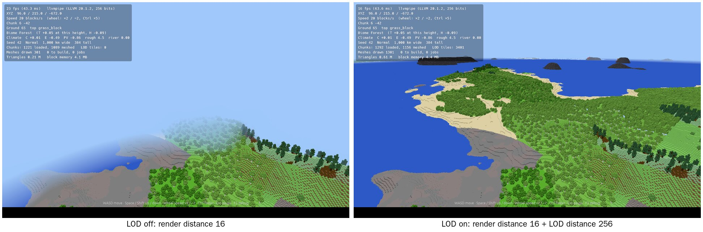
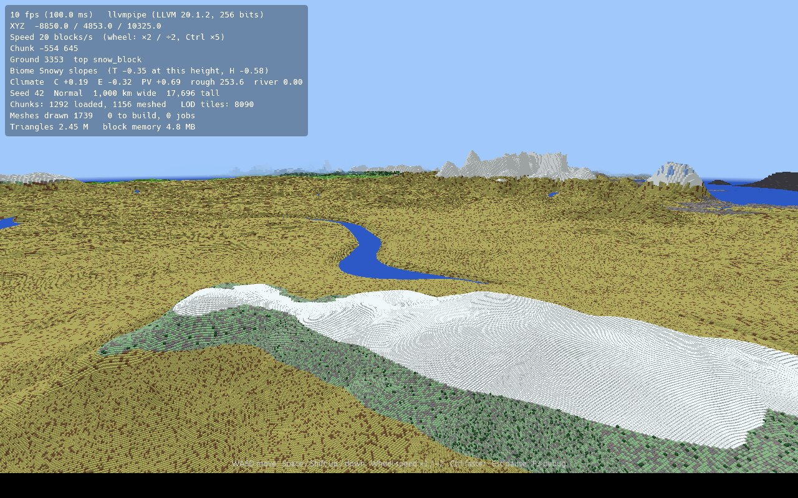
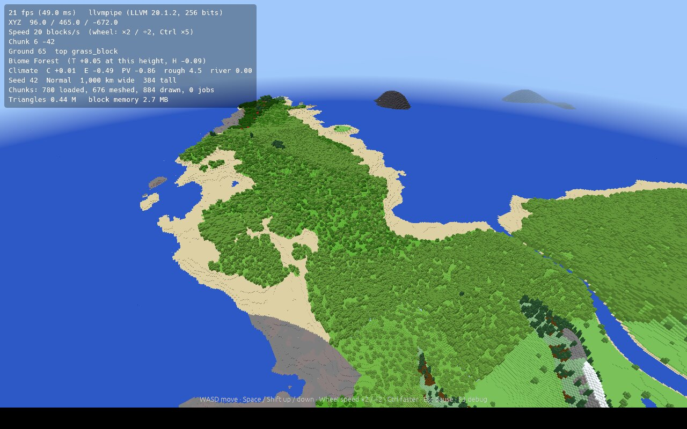

# Devlog 04: Scale and speed

Step 4 is big, so it lands in parts, each with its own pull request:

| Part | What | Status |
|------|------|--------|
| 4a | Tall worlds: world height from 256 to 17,696 blocks | Done (PR #5) |
| 4b | Far view: two distance settings, LOD rings out to 256 chunks | Done (this PR) |
| 4c | Speed: binary greedy meshing, packed vertices, GPU-driven drawing, in-game world map | Next |



## In plain words (no coding knowledge needed)

### Part 4a: tall worlds


**What changed:** you can now choose how tall the world is, the same way
you choose how wide it is. The "Create world" screen has a new **World
height** setting with a list of ready-made choices (256, 384 like
Minecraft, 1,000, 2,000, 5,000, 10,000 and 17,696 blocks) and a slider for
anything in between. The tallest choice is twice the height of Mount
Everest (8,849 m, so about 17,700 blocks, rounded to 17,696 because the
world is built from 16-block layers).

**How it works:** a taller world is not just the same world with more
empty sky. Everything grows with it: mountains climb higher and oceans
get deeper. In the 17,696-block world the highest peak near the start is
almost 9,800 blocks tall and the deepest ocean floor is 2,200 blocks
below the waves. To keep the slopes walkable instead of turning every
hill into a sheer cliff, the land also stretches sideways by the same
amount, so continents and mountain ranges are wider too. The map is the
same shape, just bigger, like zooming in on a photo:


Snow lines, tree lines and the cold at high altitude follow the mountains
up, so a tall world still has forests at the bottom of a mountain and
snow at the top, not snow everywhere. The sea stays at the same level
(y = 63) in every world.

**Does a tall world cost more?** Much less than you'd expect. The game
only builds and stores the layers near the ground, from a little under
the surface up to the treetops. Solid rock far underground and empty sky
far above are not stored at all. A chunk of a 17,696-block world takes
about the same memory as a normal one (3.3 KB against 3.6 KB) and takes
about 4 times longer to build (3.5 ms instead of 0.9 ms), not 46 times.

**How we know it's right:** 71 automatic tests (4 more than step 3). New
ones check that:
- the world height setting rounds and clamps correctly, and old saved
  settings without a height still load as the normal 384-block world;
- the quick "what's at this spot" answer the map, the menu preview and the
  trees rely on matches the real built chunk at 256, 1,000, 5,000 and
  17,696 blocks, and in Amplified mode at 17,696;
- a tall world has the same land and sea in the same (scaled) places as a
  normal one, with peaks above 2,000 blocks but never through the ceiling;
- snow lines, peaks and slopes move up with the mountains;
- a tall chunk stores fewer than 120 layers and less than 400 KB.

The normal 384-block world comes out the same as before: same height
statistics and same speed.

### Part 4b: seeing far

**What changed:** the Settings screen now has two distances instead of
one:

- **Render distance**, up to 64 chunks (was 32): the area around you that
  is built block by block, exactly as before.
- **LOD distance**, up to 256 chunks: beyond the render distance, the
  world continues as a simplified version of itself out to 4 km in every
  direction, so you see coastlines, forests, mountains and islands on the
  horizon instead of fog. 256 chunks in every direction is a 512 × 512
  square, the 262,144 chunks you asked for.

**How it works:** this is the trick that Distant Horizons and Voxy use.
Far away, the world is drawn with bigger "blocks": 2 blocks wide just past
the render distance, then 4, 8, 16, … each ring twice as coarse as the one
before. Something twice as far looks half as big, so you can't tell the
difference, and the far rings cost very little. Each coarse block takes
its height and colour from the real world at that spot, including trees,
water and snow, so the far view is the same world, not a painting. When
you move, new rings are built in the background, and the old ones stay on
screen until the new ones are ready, so the horizon never shows holes.

In tall worlds the mountains are tens of km wide, so the far view
stretches with them: a 17,696-block world shows mountains up to 188 km
away.



**What it costs:** the whole 4 km view (1,156 chunks plus 3,401 coarse
tiles) is 0.6 million triangles, about 3 times what the chunks alone
draw. It takes about 12 seconds of processor time to build once, spread
over all processor cores, and then only the edges are rebuilt as you move.

**How we know it's right:** 83 automatic tests (12 more than part 4a). The
most important new one builds the far view at full detail (1-block cells)
and checks that it matches the real chunks block for block, trees
included. Others check that the rings cover the view exactly once (no
gaps, no overlaps), that neighbouring rings differ by one step of detail,
that moving the camera never draws two things in the same place or
something that isn't ready, and that old rings are thrown away once
replaced.



---

## Technical log, part 4a: tall worlds

### World height setting (`settings.rs`)

`WorldSettings` gained `height: WorldHeight` (serde default = 384, so old
`settings.ron` files keep working). `WorldHeight::from_blocks` clamps to
`MIN_WORLD_HEIGHT = 256 ..= MAX_WORLD_HEIGHT = 17,696` and rounds to a
whole number of 16-block sections.

From the height we derive one number, `terrain_scale = height / 384`, and
the vertical range:

| Chosen | Stored height | `terrain_scale` | `min_y` | `max_y` |
|-------:|--------------:|----------------:|--------:|--------:|
| 256    | 256           | 0.67            | −48     | 207     |
| 384    | 384           | 1.00            | −64     | 319     |
| 1,000  | 1,008         | 2.63            | −176    | 831     |
| 5,000  | 5,008         | 13.0            | −832    | 4,175   |
| 10,000 | 10,000        | 26.0            | −1,664  | 8,335   |
| 17,696 | 17,696        | 46.1            | −2,944  | 14,751  |

`min_y = −16 · round(4 · scale)` keeps the default exactly at −64 and puts
the bottom on a section boundary. Sea level stays at 63 in every world:
moving it would move every beach, river and biome boundary that is tied to
it, and players expect y = 63 to be the sea.

### Scaling the terrain

`TerrainShaper::new(seed, world_type, terrain_scale)` multiplies the
horizontal noise scale by `terrain_scale` (the same mechanism Large
biomes uses) and, at the end of `shape()`, stretches the result
vertically around sea level:

```
height    = SEA + (h − SEA) · vscale
roughness = roughness · vscale
```

Scaling both axes by the same factor keeps every slope angle, so a tall
world looks like a magnified normal world rather than a field of spikes.
The 3D density noise uses the same scale, so overhangs and cliffs keep
their proportions too. The test `tall_worlds_scale_the_terrain` samples
1,600 points in a 16 km square of a normal world and the matching scaled
points of a 17,696 world: base heights agree within 3 blocks after
un-scaling and over 90 % of points agree on land vs. water (the rest are
coastline pixels where the 3D noise lands on a different sample point).

A side effect worth knowing: a tall world needs to be wide. A 17,696
block world has continents ~46 × wider, so a 16 km world of that height
is open ocean. The create-world preview zooms out with the height (16 km ×
scale) so you can see this before creating the world.

### Altitude rules in biomes and surfaces

`Shape::normalized_y(y)` maps a block height back to the equivalent height
in a 384-block world: `SEA + (y − SEA) / vscale`. Rules about *mountains*
use it: lapse rate (`t − max(0, alt − 15)/160`), peaks (125 / 85), slopes
(55), fjords (≤ 14), karst and swamp limits, the snow line (200) and the
tree line (160, crags 120). Rules about the *sea* stay in absolute blocks
because the sea and beaches don't grow: underwater, beaches (≤ 3 above
sea), mangroves (down to −4) and shallow ocean temperature. The test
`altitude_rules_scale_with_tall_worlds` checks both groups.

### Storage: a window of sections (`chunk.rs`)

A 17,696 column is 1,106 sections of 16³. Storing them all, even
palette-compressed, would cost far too much memory and time. Almost all of
them are uniform: solid stone below the surface or air above it. So a
`Chunk` now stores:

- `floor`: section 0, always stored (bedrock and deep caves later);
- `window`: a contiguous run of stored sections starting at
  `window_start`;
- below the window everything is stone, above it everything is air.

`chunk.section(i)` returns a `SectionRef` (`Uniform(block)` or
`Stored(&PalettedSection)`), so readers never need to know whether a
section is stored. `section_mut` materialises sections when a write lands
outside the window. `Chunk::assemble` trims leading stone and trailing air
sections from what the generator produced.

This is a 1D form of cubic chunks: the column is still the unit of
generation and streaming, but storage scales with the surface's local
relief, not with the world height. Full 3D streaming (loading only the
sections near the camera) becomes useful once there are caves; for a
surface-only world the window already is "the sections near the surface".

### Generation (`generator.rs`)

1. Sample the 5×5 grid of shapes for the chunk and find the lowest and
   highest possible surface: `H ± A` on every grid corner, where `A` is the
   roughness that bounds the 3D noise.
2. The window runs from `SUBSURFACE = 44` blocks below the lowest surface
   (enough for every surface rule: sand, terracotta strata, limestone) to
   the highest surface plus `TREE_HEADROOM = 30` (or sea level if higher).
3. Only the window is filled. Cells are `4 × cell_y × 4` with `cell_y = 8k`
   (`k` the largest power of two ≤ min(scale, 16)), so tall worlds
   interpolate over taller cells: the density is smoother there anyway.
4. `span_state`: density is trilinear inside a cell, so if all 8 corners
   are clearly positive (or clearly negative, margin 1e-6) the whole cell
   is stone (or air/water) and is filled without evaluating the
   interpolation per block. This took tall worlds from 7.7 to 3.5 ms per
   chunk and leaves the default world bit-identical.
5. Chunks with any column outside the world border still take the old,
   complete path.

`sample_column` scans cell by cell from the top of the same range and so
agrees with `generate_chunk`. `column_sample_matches_generated_chunk` now
runs for every world type × trees on/off, plus heights 256, 1,000, 5,000,
17,696 and Amplified at 17,696, and also checks that `min_y + 8` is stone.

`find_spawn` scales its search radius and step with the terrain, and looks
for a spot below normalized height 140 so you don't spawn on a 9 km peak.

### Game

- Create-world screen: **World height** row (preset combo box + log
  slider + `y min to max · sea at 63 · terrain ×scale`, and the rounded
  height when it differs from the chosen one).
- HUD: `Seed 42  Normal  1,000 km wide  17,696 tall`.
- The camera is clamped to the world's own `min_y .. max_y + 200`.
- The far plane covers the vertical distance to the loaded meshes as well
  as the horizontal view distance, so a valley 5,000 blocks below you is
  not clipped. Fog stays horizontal.
- The mesher only meshes the floor section and the window (± 1 section),
  so tall worlds produce no extra work for the buried and empty sections.
- `WG_HEIGHT=<blocks>` sets the height with `WG_AUTOSTART`.

### Tools

- `wg-map --height BLOCKS`. The height tint, water depth and slope shading
  are normalised by the terrain scale.
- `find_biome SEED NAME [HEIGHT]` searches a scaled area for tall worlds.

### Measurements

Seed 42, one thread, 32 × 32 chunks around the origin
(`wg-map --bench 32 --height H`, release build, cloud container CPU):

| Height | ms / chunk | stored KiB / chunk |
|-------:|-----------:|-------------------:|
| 384    | 0.91       | 3.6                |
| 5,000  | 1.70       | 3.4                |
| 17,696 | 3.51       | 3.3                |

Surface heights over the maps above (512² samples):

| Height | min    | p10    | p50 | p90   | p99   | max   | land  |
|-------:|-------:|-------:|----:|------:|------:|------:|------:|
| 384    | 14     | 27     | 66  | 90    | 155   | 274   | 56.4 %|
| 5,000  | −564   | −401   | 103 | 419   | 1,279 | 2,755 | 56.4 %|
| 17,696 | −2,160 | −1,577 | 207 | 1,323 | 4,341 | 9,793 | 56.4 %|

In game (lavapipe software renderer, 1280×800, render distance 22,
17,696 world at x −8850 z 10325, y 3,413): 43 FPS, 2,209 chunks loaded,
8 MB of block memory, validation layer clean.


### Known limitations

- At render distance 22 (352 blocks) a mountain in a tall world fills the
  view as one slope, because the mountain is tens of km wide. That is what
  the LOD rings in part 4b are for.
- There are no caves yet, so the floor section and the window are all
  that is ever needed.

---

## Technical log, part 4b: LOD rings

### Sampling far terrain (`worldgen::lod`)

`WorldGenerator::lod_grid(x0, z0, cell, n)` returns an `n × n` grid of
`LodColumn { inside, top_y, block, biome, ground_y }`, one per
`cell × cell` block square. It lives in `worldgen` because it is
generation logic and must be testable without a GPU.

- **Ground:** `sample_column` at the centre of the cell: the real
  surface, not an average. Under water the top is the water (or ice)
  surface at sea level.
- **Trees, cells ≤ 8 blocks:** every tree candidate within
  `TREE_REACH` of the grid is resolved and built with the chunk
  generator's own `trees::resolve`/`trees::build`, in the same global cell
  order, and each block is rasterised into its cell with the chunk's
  overlap rules (logs replace water and leaves; leaves replace nothing).
  The trunk's ground comes from the cell sample when the trunk is inside
  the grid (exact for 1-block cells) and from a fresh `sample_column`
  otherwise.
- **Trees, larger cells:** only the candidate of the tree-grid cell
  under the LOD cell's centre is tested. The fraction of cells showing
  canopy then equals the forest's density, which is what the eye sees at
  that distance.

Tests:

- `one_block_cells_match_generated_chunks_exactly`: for 4 chunks each of
  seeds 42 and 7 (Normal), 3 (Amplified) and 42 at height 2,000, a
  1-block LOD grid equals the highest non-air block of every column of
  the generated chunk, block id included (logs, leaves, water, ice).
- `coarse_cells_follow_the_terrain`: 16-block cells over 1 km² report the
  real surface at their centre and at most a tree above it.
- `coarse_canopy_matches_forest_density`: in a forest and a desert of
  seed 42, the share of canopy cells at 16-block cells is within 0.1 of
  the share in the exact 1-block grid (forest 0.12 vs 0.18, desert 0.016
  vs 0).
- `outside_the_border_is_empty`.

### The quadtree (`game::lod`)

`NodeKey { level, x, z }`: level 0 is a chunk; a level-`L` tile covers
`2^L × 2^L` chunks with 16 × 16 cells of `2^L` blocks. Starting from the
coarsest level that reaches the LOD distance, a node splits while its
Chebyshev distance (in chunks) to the camera chunk is below

```
split_dist(1)   = render_distance + 1
split_dist(L+1) = split_dist(L) + RING_TILES · 2^L        (RING_TILES = 8)
```

so every ring is 8 of its own tiles wide and neighbouring leaves differ by
at most one level. With render distance 16 and LOD distance 256 that is
1,156 chunks (the render distance, rounded out to whole level-1 tiles)
plus 3,401 tiles in rings of 2, 4, 8 and 16-block cells. The same area in
chunks would be 263,169 chunks.

Tests: `leaves_tile_the_view_without_gaps_or_overlaps` (6 layouts × 3
camera positions, including x = 123,457 chunks; every chunk of the view
square covered exactly once, chunks up to the render distance are level
0), `neighbouring_leaves_differ_by_at_most_one_level`,
`detail_halves_as_distance_doubles`, `world_border_prunes_nodes`.

### Swapping without holes

`Layout::draw_set` walks the quadtree again with the set of meshes that
are *ready* (on the GPU):

- a leaf that is ready draws itself;
- a leaf that isn't, but whose four children are (the camera moved away
  and four tiles are merging into one), draws the children;
- a node that should split but whose finer meshes aren't all ready yet
  draws itself, if it is ready.

Meshes that are neither leaves nor drawn are evicted. The streamer hands
the renderer at most `MAX_UPLOADS_PER_FRAME` meshes per frame, exactly
what the renderer uploads in one frame, so "ready" really means "on the
GPU" and a swap never shows a frame with a hole.
`lod_rings_stream_swap_and_evict` streams a view, jumps 30 chunks away
and checks every intermediate frame: nothing drawn that isn't uploaded,
never two meshes over the same chunk, and at the end exactly the new
leaves left on the GPU.

### Tile meshes

18 × 18 cells are sampled (one border cell each side). Tops are greedy
merged by (height, block, tinted colour). Each cell gets a wall to every
lower neighbour; on the tile edge the wall reaches one more cell size
down (a "skirt") so a neighbour tile of another level never shows a
crack. Vertices use the chunk format and pipeline, positioned relative to
the tile corner.

### Renderer

- Meshes are keyed by `NodeKey`; each frame draws the streamer's draw
  list instead of every mesh, with frustum culling on the tile's box.
- **Reverse-Z with an infinite far plane** (`perspective_infinite_reverse_rh`,
  depth cleared to 0, `GREATER_OR_EQUAL`). With the old 0.1-near
  standard depth, D32F resolution at 4 km was about 15 blocks; reversed,
  float depth keeps ~7 significant digits at any distance. Test:
  `depth_is_reversed` (surfaces 0.5 blocks apart at 4,000 blocks get
  different depths). Frustum planes with no normal (the infinite far
  plane) accept everything.
- Fog ends at the LOD distance (horizontal distance, as before).

### Settings and streaming

- `render_distance` 2..=64, new `lod_distance` 0..=256 (default 12 and
  128); old `settings.ron` files load with the default LOD distance.
- In tall worlds the effective LOD distance is multiplied by the terrain
  scale: 256 → 11,797 chunks at 17,696 blocks, 8,090 tiles (top level 10).
- The streamer (`world.rs`) schedules leaves nearest first: chunks (and
  their neighbours) are generated then meshed as before, tiles are sampled
  and meshed in one job. Block data is kept 2 chunks past the chunk
  radius.
- HUD: `LOD tiles`, meshes drawn, pieces left to build. The log prints
  how long the first full view took.

### Measurements

Tile sampling, one thread (`wg-map --bench 32`, an 18 × 18 grid per
tile):

| Level (cell) | ms/tile, height 384 | ms/tile, height 17,696 |
|-------------:|--------------------:|-----------------------:|
| 1 (2 blocks) | 2.82 | 3.89 |
| 2 (4)        | 2.56 | 4.18 |
| 3 (8)        | 3.29 | 5.17 |
| 4 (16)       | 3.38 | 3.37 |
| 6 (64)       | 3.54 | 3.13 |
| 8 (256)      | 2.94 | 2.83 |

A tile costs about 3 chunks of generation but covers up to 65,536
chunks of area.

In game, seed 42 at (96, −672), 1280×800, lavapipe software renderer on
the 4-core cloud container (so the CPU renders *and* generates):

| Setup | First full view | Meshes drawn | Triangles | FPS |
|-------|----------------:|-------------:|----------:|----:|
| Render 16, LOD off | 6.2 s | 301 | 0.21 M | 23 |
| Render 12, LOD 128 | n/a | 868 | 0.44 M | 17 |
| Render 16, LOD 256 | 28.9 s | 1,301 | 0.61 M | 16 |
| Render 16, LOD 256, height 17,696 (LOD 11,797) | 77.2 s | 1,739 | 2.45 M | 10 |

The validation layer reports no errors. On a real GPU these triangle
counts are small (an RTX 2080 draws hundreds of millions per second);
the remaining costs are one draw call per mesh and 16-byte vertices,
which part 4c replaces with indirect drawing and packed vertices.

### Known limitations (4b)

- Rendering 64 chunks of full detail is allowed but heavy until part 4c
  (16,641 chunk meshes with 16-byte vertices and one draw call each).
- A tile is rebuilt from scratch when it comes back into view; there is
  no cache yet.
- Caves and overhangs are not visible in LOD tiles (they are a top-down
  view); in the 1-block test they don't matter because only the top block
  is compared.
