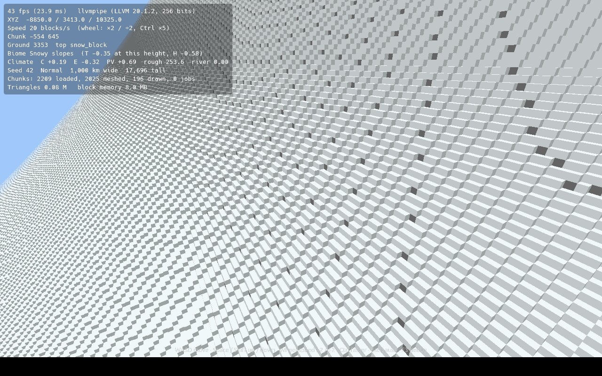
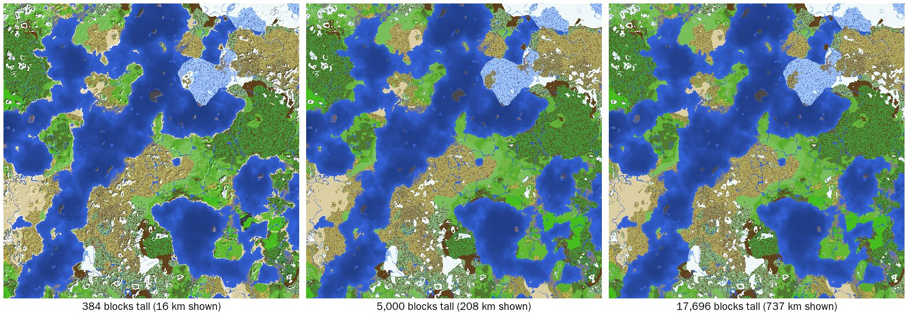
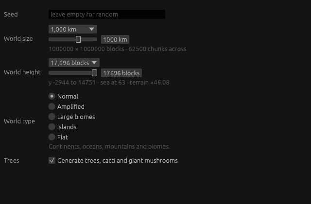

# Devlog 04: Scale and speed

Step 4 is big, so it lands in parts, each with its own pull request:

| Part | What | Status |
|------|------|--------|
| 4a | Tall worlds: world height from 256 to 17,696 blocks | This PR |
| 4b | Far view: two distance settings, LOD rings out to 256 chunks | Next |
| 4c | Speed: binary greedy meshing, packed vertices, GPU-driven drawing, in-game world map | After 4b |



## In plain words (no coding knowledge needed)

**What changed:** you can now choose how tall the world is, the same way
you choose how wide it is. The "Create world" screen has a new **World
height** setting with a list of ready-made choices (256, 384 like
Minecraft, 1,000, 2,000, 5,000, 10,000 and 17,696 blocks) and a slider for
anything in between. The tallest choice is twice the height of Mount
Everest (8,849 m, so about 17,700 blocks, rounded to 17,696 because the
world is built from 16-block layers).

**How it works:** a taller world is not just the same world with more
empty sky. Everything grows with it: mountains climb higher and oceans
get deeper. In the 17,696-block world the highest peak near the start is
almost 9,800 blocks tall and the deepest ocean floor is 2,200 blocks
below the waves. To keep the slopes walkable instead of turning every
hill into a sheer cliff, the land also stretches sideways by the same
amount, so continents and mountain ranges are wider too. The map is the
same shape, just bigger, like zooming in on a photo:



Snow lines, tree lines and the cold at high altitude follow the mountains
up, so a tall world still has forests at the bottom of a mountain and
snow at the top, not snow everywhere. The sea stays at the same level
(y = 63) in every world.

**Does a tall world cost more?** Much less than you'd expect. The game
only builds and stores the layers near the ground, from a little under
the surface up to the treetops. Solid rock far underground and empty sky
far above are not stored at all. A chunk of a 17,696-block world takes
about the same memory as a normal one (3.3 KB against 3.6 KB) and takes
about 4 times longer to build (3.5 ms instead of 0.9 ms), not 46 times.

**How we know it's right:** 71 automatic tests (4 more than step 3). New
ones check that:
- the world height setting rounds and clamps correctly, and old saved
  settings without a height still load as the normal 384-block world;
- the quick "what's at this spot" answer the map, the menu preview and the
  trees rely on matches the real built chunk at 256, 1,000, 5,000 and
  17,696 blocks, and in Amplified mode at 17,696;
- a tall world has the same land and sea in the same (scaled) places as a
  normal one, with peaks above 2,000 blocks but never through the ceiling;
- snow lines, peaks and slopes move up with the mountains;
- a tall chunk stores fewer than 120 layers and less than 400 KB.

The normal 384-block world comes out the same as before: same height
statistics and same speed.

---

## Technical log

### World height setting (`settings.rs`)

`WorldSettings` gained `height: WorldHeight` (serde default = 384, so old
`settings.ron` files keep working). `WorldHeight::from_blocks` clamps to
`MIN_WORLD_HEIGHT = 256 ..= MAX_WORLD_HEIGHT = 17,696` and rounds to a
whole number of 16-block sections.

From the height we derive one number, `terrain_scale = height / 384`, and
the vertical range:

| Chosen | Stored height | `terrain_scale` | `min_y` | `max_y` |
|-------:|--------------:|----------------:|--------:|--------:|
| 256    | 256           | 0.67            | −48     | 207     |
| 384    | 384           | 1.00            | −64     | 319     |
| 1,000  | 1,008         | 2.63            | −176    | 831     |
| 5,000  | 5,008         | 13.0            | −832    | 4,175   |
| 10,000 | 10,000        | 26.0            | −1,664  | 8,335   |
| 17,696 | 17,696        | 46.1            | −2,944  | 14,751  |

`min_y = −16 · round(4 · scale)` keeps the default exactly at −64 and puts
the bottom on a section boundary. Sea level stays at 63 in every world:
moving it would move every beach, river and biome boundary that is tied to
it, and players expect y = 63 to be the sea.

### Scaling the terrain

`TerrainShaper::new(seed, world_type, terrain_scale)` multiplies the
horizontal noise scale by `terrain_scale` (the same mechanism Large
biomes uses) and, at the end of `shape()`, stretches the result
vertically around sea level:

```
height    = SEA + (h − SEA) · vscale
roughness = roughness · vscale
```

Scaling both axes by the same factor keeps every slope angle, so a tall
world looks like a magnified normal world rather than a field of spikes.
The 3D density noise uses the same scale, so overhangs and cliffs keep
their proportions too. The test `tall_worlds_scale_the_terrain` samples
1,600 points in a 16 km square of a normal world and the matching scaled
points of a 17,696 world: base heights agree within 3 blocks after
un-scaling and over 90 % of points agree on land vs. water (the rest are
coastline pixels where the 3D noise lands on a different sample point).

A side effect worth knowing: a tall world needs to be wide. A 17,696
block world has continents ~46 × wider, so a 16 km world of that height
is open ocean. The create-world preview zooms out with the height (16 km ×
scale) so you can see this before creating the world.

### Altitude rules in biomes and surfaces

`Shape::normalized_y(y)` maps a block height back to the equivalent height
in a 384-block world: `SEA + (y − SEA) / vscale`. Rules about *mountains*
use it: lapse rate (`t − max(0, alt − 15)/160`), peaks (125 / 85), slopes
(55), fjords (≤ 14), karst and swamp limits, the snow line (200) and the
tree line (160, crags 120). Rules about the *sea* stay in absolute blocks
because the sea and beaches don't grow: underwater, beaches (≤ 3 above
sea), mangroves (down to −4) and shallow ocean temperature. The test
`altitude_rules_scale_with_tall_worlds` checks both groups.

### Storage: a window of sections (`chunk.rs`)

A 17,696 column is 1,106 sections of 16³. Storing them all, even
palette-compressed, would cost far too much memory and time. Almost all of
them are uniform: solid stone below the surface or air above it. So a
`Chunk` now stores:

- `floor`: section 0, always stored (bedrock and deep caves later);
- `window`: a contiguous run of stored sections starting at
  `window_start`;
- below the window everything is stone, above it everything is air.

`chunk.section(i)` returns a `SectionRef` (`Uniform(block)` or
`Stored(&PalettedSection)`), so readers never need to know whether a
section is stored. `section_mut` materialises sections when a write lands
outside the window. `Chunk::assemble` trims leading stone and trailing air
sections from what the generator produced.

This is a 1D form of cubic chunks: the column is still the unit of
generation and streaming, but storage scales with the surface's local
relief, not with the world height. Full 3D streaming (loading only the
sections near the camera) becomes useful once there are caves; for a
surface-only world the window already is "the sections near the surface".

### Generation (`generator.rs`)

1. Sample the 5×5 grid of shapes for the chunk and find the lowest and
   highest possible surface: `H ± A` on every grid corner, where `A` is the
   roughness that bounds the 3D noise.
2. The window runs from `SUBSURFACE = 44` blocks below the lowest surface
   (enough for every surface rule: sand, terracotta strata, limestone) to
   the highest surface plus `TREE_HEADROOM = 30` (or sea level if higher).
3. Only the window is filled. Cells are `4 × cell_y × 4` with `cell_y = 8k`
   (`k` the largest power of two ≤ min(scale, 16)), so tall worlds
   interpolate over taller cells: the density is smoother there anyway.
4. `span_state`: density is trilinear inside a cell, so if all 8 corners
   are clearly positive (or clearly negative, margin 1e-6) the whole cell
   is stone (or air/water) and is filled without evaluating the
   interpolation per block. This took tall worlds from 7.7 to 3.5 ms per
   chunk and leaves the default world bit-identical.
5. Chunks with any column outside the world border still take the old,
   complete path.

`sample_column` scans cell by cell from the top of the same range and so
agrees with `generate_chunk`. `column_sample_matches_generated_chunk` now
runs for every world type × trees on/off, plus heights 256, 1,000, 5,000,
17,696 and Amplified at 17,696, and also checks that `min_y + 8` is stone.

`find_spawn` scales its search radius and step with the terrain, and looks
for a spot below normalized height 140 so you don't spawn on a 9 km peak.

### Game

- Create-world screen: **World height** row (preset combo box + log
  slider + `y min to max · sea at 63 · terrain ×scale`, and the rounded
  height when it differs from the chosen one).
- HUD: `Seed 42  Normal  1,000 km wide  17,696 tall`.
- The camera is clamped to the world's own `min_y .. max_y + 200`.
- The far plane covers the vertical distance to the loaded meshes as well
  as the horizontal view distance, so a valley 5,000 blocks below you is
  not clipped. Fog stays horizontal.
- The mesher only meshes the floor section and the window (± 1 section),
  so tall worlds produce no extra work for the buried and empty sections.
- `WG_HEIGHT=<blocks>` sets the height with `WG_AUTOSTART`.

### Tools

- `wg-map --height BLOCKS`. The height tint, water depth and slope shading
  are normalised by the terrain scale.
- `find_biome SEED NAME [HEIGHT]` searches a scaled area for tall worlds.

### Measurements

Seed 42, one thread, 32 × 32 chunks around the origin
(`wg-map --bench 32 --height H`, release build, cloud container CPU):

| Height | ms / chunk | stored KiB / chunk |
|-------:|-----------:|-------------------:|
| 384    | 0.91       | 3.6                |
| 5,000  | 1.70       | 3.4                |
| 17,696 | 3.51       | 3.3                |

Surface heights over the maps above (512² samples):

| Height | min    | p10    | p50 | p90   | p99   | max   | land  |
|-------:|-------:|-------:|----:|------:|------:|------:|------:|
| 384    | 14     | 27     | 66  | 90    | 155   | 274   | 56.4 %|
| 5,000  | −564   | −401   | 103 | 419   | 1,279 | 2,755 | 56.4 %|
| 17,696 | −2,160 | −1,577 | 207 | 1,323 | 4,341 | 9,793 | 56.4 %|

In game (lavapipe software renderer, 1280×800, render distance 22,
17,696 world at x −8850 z 10325, y 3,413): 43 FPS, 2,209 chunks loaded,
8 MB of block memory, validation layer clean.



### Known limitations

- At render distance 22 (352 blocks) a mountain in a tall world fills the
  view as one slope, because the mountain is tens of km wide. That is what
  the LOD rings in part 4b are for.
- There are no caves yet, so the floor section and the window are all
  that is ever needed.
