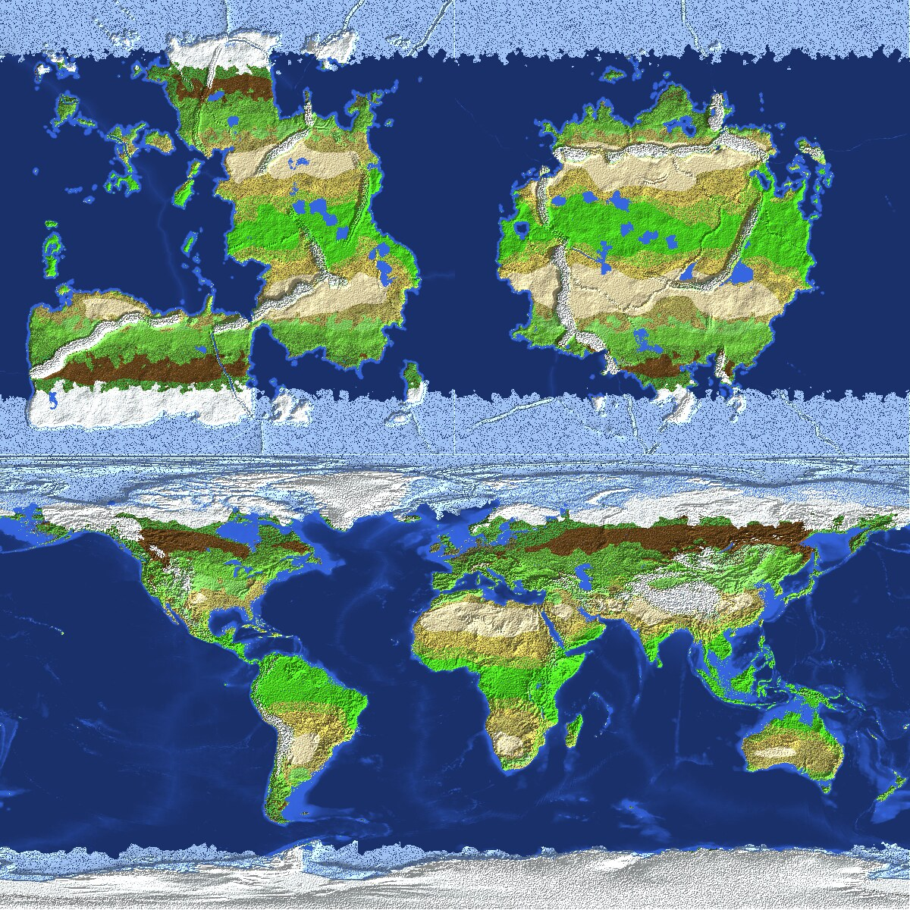
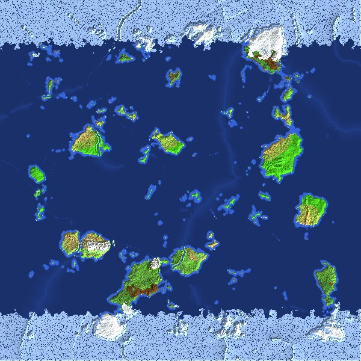
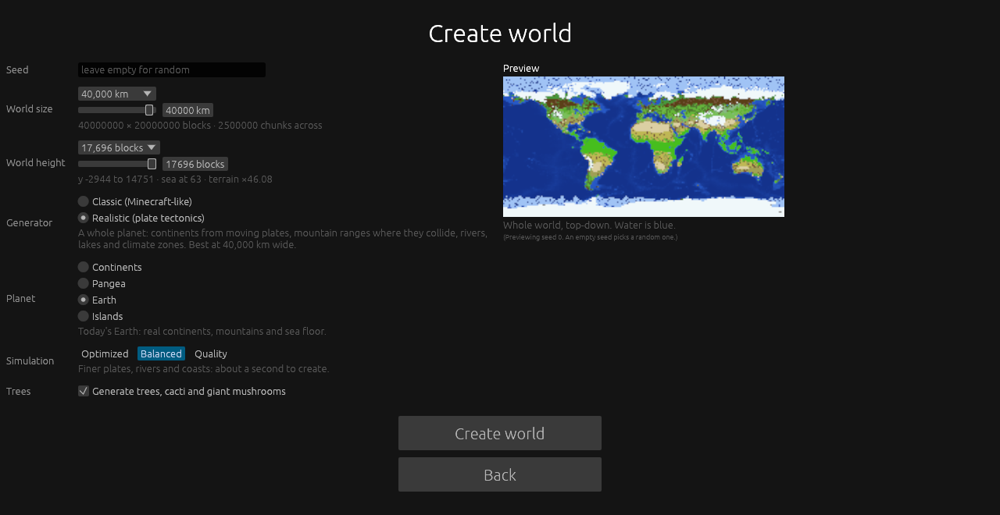
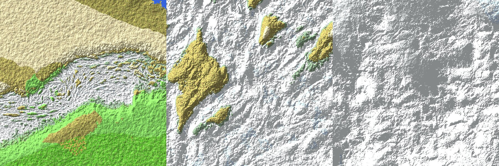
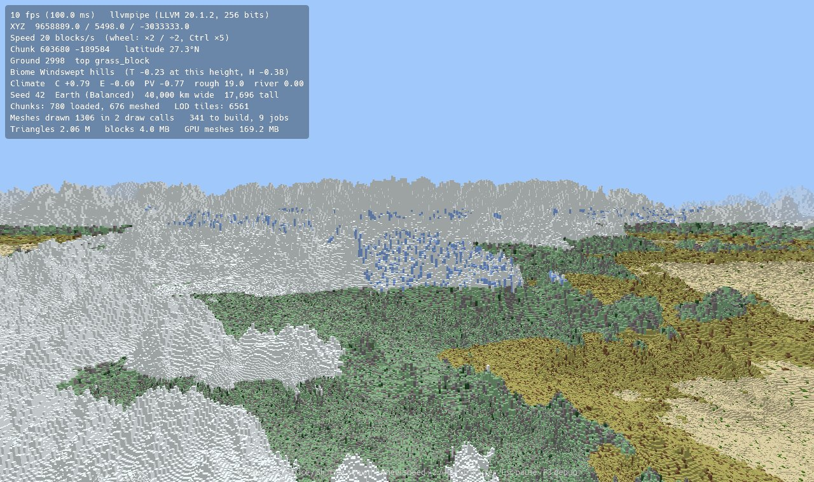
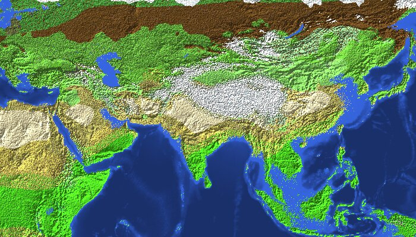
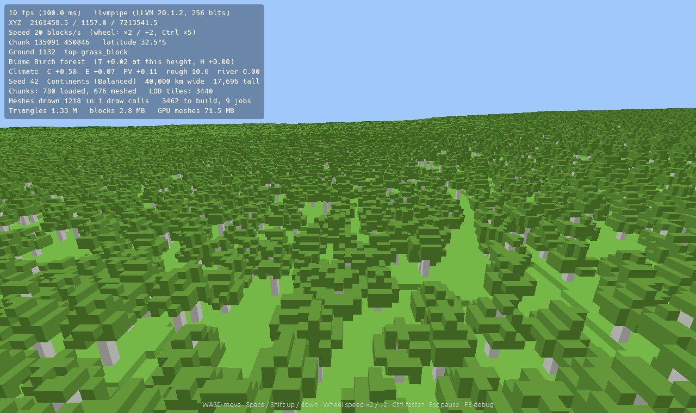

# Devlog 05: A realistic planet

Step 5 adds a second way to make worlds. The original generator (now
called **Classic**) stays exactly as it was. The new one, **Realistic**,
builds a whole Earth-like planet: continents on moving tectonic plates,
mountain ranges where plates collide, oceans that get deeper away from
their mid-ocean ridges, rivers that drain whole continents to the sea,
lakes, deserts and rainforests where the climate puts them.

## In plain words (no coding knowledge needed)

**What changed:** on the "Create world" screen you now choose a
**Generator**: Classic (the Minecraft-style world from steps 1 to 4) or
Realistic. Realistic offers four **planets**:

| Planet | What you get |
|---|---|
| Continents | Several continents from a random plate layout, like today's Earth |
| Pangea | One supercontinent in a world ocean, like Earth 250 million years ago |
| Earth | The real Earth: today's continents, mountains and ocean floor from NOAA satellite and sonar data |
| Islands | A water world of archipelagos, island arcs and volcanic chains |

and a **Simulation** quality: **Optimized** (ready in under half a
second), **Balanced** (about a second, the default) or **Quality** (a few
seconds, with three times as many rivers). The Settings screen also got
the same three choices for graphics (Optimized, Balanced, Quality), which
set the view distances in one click.

**How it works:** the Classic generator decides every spot from local
random patterns, so it has no idea where it is on a planet. A real
mountain range is where it is because two plates pushed against each
other; a desert is where it is because of its latitude and the mountains
that block the rain. So the Realistic generator first simulates the whole
planet, once, when you create the world:

1. **Plates.** The planet is split into 10 to 14 plates, each moving in
   its own direction. Where two continents collide, a high range and a
   plateau rise (like the Himalaya and Tibet). Where an ocean plate dives
   under a continent, there is a deep trench offshore and a volcanic range
   on the coast (like the Andes). Where plates pull apart, the ocean floor
   has a ridge in the middle and deepens as it gets older and colder.
2. **Climate.** Temperature comes from latitude and ocean currents. Rain
   comes from the global wind belts: wet near the equator, deserts around
   25° north and south, wet again at mid-latitudes. Wind carries moisture
   inland and loses it on mountains, so the far side of a range is dry
   (a "rain shadow"), and monsoons bring summer rain to tropical coasts.
3. **Rivers and erosion.** Rain runs downhill to the sea. Rivers carve
   valleys over many simulated steps, and mud fills the low basins. Where
   water can't escape, a lake forms if the climate is wet enough to keep
   it full, or a dry salt flat if it isn't.

Then, when you walk around, every block is computed from that planet plus
fine detail: long parallel ridges along each mountain range, side valleys
across them, gentle hills on the plains, and rivers flowing downhill in
their own beds, all the way to the sea.

**Scale:** the planet is simulated at Earth's size. In a 40,000 km wide,
17,696-block tall world, one block is one real metre in every direction,
so a mountain you climb is as big as the real one. Smaller worlds are the
same planet shrunk to fit.

**Is it fast?** Building a chunk of a Realistic world is about six times
faster than a Classic one (0.6 ms against 3.5 ms in the tallest worlds),
because the expensive part (the planet) is done once at the start. That
start takes 0.3 to 8 seconds depending on the Simulation quality; the
game shows a loading screen with a Cancel button meanwhile.

**How we know it's right:** 107 automatic tests (75 for the generator, 32
for the game). The new ones check, among other things, that:
- every planet has the right amount of land (Earth 25–35 %, Islands
  4–20 %) and starts you on dry land;
- the same seed always makes the same planet;
- on the Earth planet, real places have real heights (the Everest area
  above 6,000 m, the Mariana Trench below −8,000 m, the Mid-Atlantic
  Ridge shallower than the Pacific floor), the Caspian Sea sits below sea
  level, Lake Victoria above 1,000 m, and there is no fake lake in the
  Congo basin;
- the windward side of a mountain range is several times wetter than
  the lee side;
- what the map and the far view show matches the blocks you walk on,
  rivers and lakes included.

**What's next:** step 6 makes chunks and the far view faster, aiming to
see as much of the world as possible at once.

---

## Technical log

### Overview

New module `crates/worldgen/src/realistic/` (2,600 lines):

| File | What |
|---|---|
| `mod.rs` | `RealisticWorld`: runs the simulation, extracts rivers and lakes, and shapes any column (`shape(x, z) -> Shape`) |
| `tectonics.rs` | Crust, plates, boundaries, relief, old orogens, hotspots |
| `climate.rs` | Temperature, precipitation, potential evapotranspiration, aridity |
| `erosion.rs` | Open sea, Priority-Flood, discharge, stream-power erosion |
| `earth.rs` | Decoder for the compressed ETOPO 2022 relief, real lakes |
| `grid.rs` | `Grid<f32>`, bilinear/bicubic sampling, blur, Euclidean distance field |

`WorldGenerator` holds a `Shaper` enum (`Classic(TerrainShaper)` or
`Realistic(Box<RealisticWorld>)`). Both return the same `terrain::Shape`
(base height, roughness, water level, river, climate), so biomes, surface
rules, trees, chunk generation, `sample_column`, LODs, maps and the game
work unchanged. The Classic path is untouched and every pre-existing
test passes unchanged.

Settings (`settings.rs`): `Generator {Classic, Realistic}`,
`Planet {Continents, Pangea, Earth, Islands}`, `SimQuality {Fast
("Optimized"), Balanced, Quality}`. The planet and quality are part of the
world's identity, like the seed. The Earth planet is twice as wide as it is
deep (equirectangular); `WorldSize::half_depth` handles that everywhere
(border, camera clamp, streaming, map).

### Stage 1: planet simulation

Grid sizes (cells across), erosion steps and smallest river kept:

| Quality | Continents / Pangea / Islands | Earth |
|---|---|---|
| Optimized | 384², 6 steps, 600 m³/s | 1200 × 600 |
| Balanced | 768², 10 steps, 250 m³/s | 1800 × 900 |
| Quality | 1536², 14 steps, 100 m³/s | 3600 × 1800 |

**Tectonics** (`tectonics.rs`), a kinematic model after Cortial et al.
2019, *Procedural Tectonic Planets*:

1. Continental crust from a thresholded noise field (≈ 40 % of the
   surface; 12 % for Islands; one blob for Pangea).
2. 10–14 plates grown from seeds with Dijkstra; crossing continental
   crust costs more, so boundaries follow oceans and margins. Per-cell
   costs are precomputed in parallel.
3. Each plate gets a drift and a spin; oceanic plates move faster.
4. For each boundary cell, the relative velocity projected on the normal
   gives convergence (> 0), divergence, or transform motion.
5. Relief from the nearest boundary of the cell's own plate (exact
   Euclidean distance field) and its type: collision range + plateau,
   Andean trench + cordillera, ocean–ocean trench + island arc, rift
   valley with shoulders, mid-ocean ridge.
6. Ocean floor depth from crustal age with the **GDH1** plate model
   (Stein & Stein 1992): `d = 2600 + 365·√t` m for t < 20 Myr, else
   `5651 − 2473·e^(−0.0278 t)`. Age t is the distance to the ridge over
   the half spreading rate (≥ 1.5 cm/yr). The first version used the
   half-space √t law at all ages and gave a median floor of −6,200 m;
   GDH1 flattens old floor to the real ≈ −5,000 to −5,600 m.
7. Old orogens (an earlier plate layout, worn down: Appalachians, Urals)
   and hotspot chains trailing behind their plate (Hawaii).

It also outputs a 0..1 `mountain` field and the **strike** of the nearest
range as a doubled angle `(cos 2θ, sin 2θ)` so it interpolates smoothly.

**Earth** (`earth.rs`): NOAA ETOPO 2022 global relief, averaged to 0.1°
(3600 × 1800), quantised to 4 m on land and 16 m at sea, coded as LOCO-I
(median edge detector) residuals, LEB128 varints, deflated: 3.9 MB,
`include_bytes!` into the library (no I/O; decoding ≈ 40 ms).
`data/make_earth_relief.py` rebuilds it. The mountain field and strike
for Earth come from local relief and gradient, so the same detail model
applies.

**Climate** (`climate.rs`), per row in parallel:

- Temperature: 28 °C at the equator to −25 °C at the poles, ±3.5 °C
  noise over ≈ 900 km (otherwise the sea-ice edge was a straight line),
  cold currents off subtropical west coasts, warm ones off mid-latitude
  west coasts. Lapse rate applied per block by the biome code.
- Zonal precipitation:
  `450 + 2300·g(0°, 11°) + 850·g(50°, 13°) − 300·smoothstep(62°, 85°)` mm,
  with a subtropical subsidence factor `0.5 + 0.3·g(0, 12) − 0.3·g(25, 6)`.
- Moisture transport along the prevailing winds (trades, westerlies,
  polar easterlies): picked up over the sea, lost inland, rained out on
  ascent with a shadow factor `exp(−0.4·Δh_km)` that recovers over
  ≈ 1,500 km; an altitude factor `exp(−max(0, e − 2000)/3000)`.
- Monsoon: a meridional sweep from the equator to 35° adds up to
  1,100 mm on windward tropical coasts.
- PET = max(150, 250 + 50·T) mm; humidity for the biome rules is the
  aridity index P/PET.

Calibration (`examples/planet_stats`, Continents, area-weighted land
below 60°) against the UNEP aridity classes for Earth:

| Class (P/PET) | Ours | Earth |
|---|---|---|
| Hyper-arid (< 0.05) | 0.5 % | 7.5 % |
| Arid (0.05–0.2) | 15.3 % | 12.1 % |
| Semi-arid (0.2–0.5) | 28.4 % | 17.7 % |
| Dry sub-humid (0.5–0.65) | 9.9 % | 9.9 % |
| Humid (> 0.65) | 45.9 % | 52.8 % |

Drylands total 54 % against Earth's 47 %; hyper-arid cores (Sahara,
Atacama) are under-represented, semi-arid over-represented.

**Erosion** (`erosion.rs`), each step:

1. `open_sea`: 8-connected fill through negative cells from the border
   and from cells below −3,000 m. A basin below sea level far from it
   (Caspian, Dead Sea) is land, not ocean.
2. Priority-Flood (Barnes et al. 2014) seeded from the open sea; only
   seeds with a non-sea neighbour go through the heap (same result,
   fewer heap operations). Gives receivers and filled levels.
3. Discharge accumulated in reverse flood order from the precipitation.
4. Stream-power incision `∂h/∂t = U − K·Q^m·S`, implicit
   (Braun & Willett 2013), so a bed never drops below its outlet.
5. Sediment: a hollow is raised by 25 % of its depth per step, so closed
   basins become plains instead of continent-sized lakes.
6. Uplift towards the tectonic heights.

**Lakes:** water-balance model. For each hollow of the final flood, the
surface grows from the deepest cell up until the evaporation excess
`(PET − P)` of the lake area equals the inflow (the largest discharge
into the hollow); kept if at least 2 cells and 10 m deep. Wet basins fill
to the rim, dry ones stay salt flats. For Earth this model can't know
real lakes (ETOPO has lake *bed* or surface, not both), and it made a
mega-lake in the Congo and Chad basins, so Earth uses a list of 26 real
lakes (Caspian −28 m, Victoria 1,134 m, Baikal 456 m, the Great Lakes,
Titicaca 3,812 m, …) filled from their nearest hollow cell, below their
real surface level.

**Rivers:** reaches above the quality's discharge threshold become a list
of nodes (position, water level, discharge), indexed in a coarse spatial
grid for nearest-reach queries.

Simulation time (4 CPU cores, release):

| Quality | Continents | Earth |
|---|---|---|
| Optimized | 0.28 s | 0.38 s |
| Balanced | 1.3–1.8 s | 0.7 s |
| Quality | 7.8 s | 2.8 s |

Quality was 17.5 s before parallelising plate costs, crust, relief and
climate with rayon and trimming the flood's heap.

### Stage 2: column shaping (`RealisticWorld::shape`)

- Base elevation, mountain and relief fields are sampled **bicubic**
  (bilinear showed straight creases along cell edges), through a domain
  warp so the grid doesn't show.
- **Detail** adds fractal noise of amplitude `relief = 90 + 2800·m^1.3`
  metres: isotropic fBm on plains, ridged multifractal in mountains
  (per-octave gain lerped from 0.574 to 0.683), and an anisotropic part
  stretched along the strike (fixed per-octave stretch 3.0, 2.4, 1.6, 1.0
  in a fixed set of directions, blended by `aniso =
  smoothstep(0.15, 0.7, m)·smoothstep(0.1, 0.4, |strike|)` and
  renormalised by `√((1−t)² + t²)`). Stretching coordinates by a
  *varying* factor made stripes; fixed stretches and a blend weight don't.
- Peaks above 7 km are soft-capped: `7000 + 2500·tanh((e − 7000)/2500)`
  (unbounded detail produced 12 km summits).
- **Rivers:** distance to the nearest reach; the bed is carved with the
  river's own water level `min(level, base − 1)`, and detail fades near
  the channel so banks are smooth.
- **Lakes:** bilinear lake mask plus jagged-shore noise; inside, water at
  the lake level and a bed that deepens from the shore; at the shore the
  ground blends up to just above the water.
- **Scale:** `h_scale = blocks per real metre` horizontally
  (world width / 40,000 km); vertically the room above the sea fits
  Everest at ≈ 92 % but never above 1:1, ocean depths are compressed
  smoothly into the room below the sea. 40,000 km × 17,696 blocks is
  the real Earth at 1:1.
- **Biome rules:** `Shape::vscale` maps real metres to "normalized
  blocks" (37.3 m each) so the classic snow line, tree line and peak rules
  apply at real altitudes; temperature and aridity come from the climate
  grid instead of noise.
- `Shape.water` (new): the water surface of the column, which can be
  above `SEA_LEVEL` in a river or lake. Chunk generation fills water up to
  it, sea ice forms at it, and `ColumnSample::water_top()` gives the
  height to stand on.

### Spawn

`pick_spawn` prefers a scenic spot: 6–20 °C, not dry, near mountains
(blurred mountain field > 0.12), not in a lake; else the old rule
(nearest dry land to the centre).

### Game

- Create-world screen: Generator radios; for Realistic, the Planet radios
  and Simulation quality buttons (Classic keeps its World type). Choosing
  Realistic suggests a 40,000 km world at full height. The preview covers
  the whole planet and is drawn on a worker thread with a spinner.
- A loading screen with a timer and Cancel while the planet is simulated
  on a background thread.
- Settings: a **Graphics** preset row: Optimized (render 8, LOD 64),
  Balanced (12, 128, the default), Quality (24, 256).
- HUD: planet and quality, and the latitude for Realistic worlds.
- Autostart variables: `WG_PLANET=continents|pangea|earth|islands`,
  `WG_QUALITY=fast|balanced|quality`, `WG_SIZE_KM=<km>`.

### Tools

- `wg-map --realistic <planet> --quality <q> --whole` renders the whole
  planet (2:1 for Earth); `--bench` is centred on the spawn.
- `examples/planet_stats [seed] [planet]`: per-latitude land
  precipitation, aridity and temperature, and the UNEP aridity class
  shares.

### Determinism

Every random choice uses `worldgen::rng` with its own sub-seeds
(`realistic/tectonics`, `realistic/detail`, …). Rayon is used only in
`par_iter().map().collect()` form, which keeps cell order, so results
don't depend on thread count. Transcendentals in the simulation go
through `libm` so they are the same on every platform.

### Measurements

Chunk generation, 17,696-block world, 40,000 km, seed 42, one thread,
1,024 chunks around the spawn (`wg-map --bench 32`):

| World | ms/chunk | KiB/chunk | LOD tile (16-block cells) |
|---|---|---|---|
| Classic | 3.51 | 3.3 | 3.6 ms |
| Realistic Continents (Balanced) | 0.60 | 3.7 | 1.1 ms |
| Realistic Earth (Balanced) | 0.54 | 4.2 | 1.0 ms |

Whole-planet maps of 600 × 600 columns take 1.2–1.7 s.

### Tests

107 tests pass (`cargo test`), `cargo clippy --all-targets` is clean.
New for this step:

- `realistic_column_sample_matches_generated_chunk`: `sample_column`
  equals the generated chunk (surface, top block, biome, water up to
  `shape.water`, ice) at spawn, a river and a lake, for Continents and
  Earth.
- `one_block_cells_match_realistic_chunks` (LOD): 1-block LOD cells equal
  the chunk's top blocks on Realistic worlds, rivers and lakes included.
- `realistic_worlds_are_deterministic`, `realistic_planets_have_their_land_share`
  (and a dry spawn), `latitude_spans_the_planet`.
- `earth_has_its_real_lakes`: Caspian between −40 and −20 m, Superior
  150–200 m, Victoria above 1,000 m, no lake in the Congo basin, more than
  500 river reaches.
- `earth::real_places_have_real_heights`: Tibet, the Everest area, the
  Altiplano, the Mariana Trench, the Pacific, the Mid-Atlantic Ridge, the
  Sahara, Antarctica, land share 27–31 % (area-weighted).
- `tectonics::plates_build_continents_ranges_and_ocean_basins`: land
  share, mountains on land, ranges higher than plains, ocean median between −6,000 and −3,500 m.
- `climate::zones_follow_latitude`, `rain_shadow_and_inland_drying`
  (windward 970 mm against 243 mm in the lee), `biome_scales`.
- `erosion::flood_drains_every_cell_to_the_sea`,
  `erosion_cuts_valleys_but_keeps_land`.
- `grid::*`: interpolation, blur, Euclidean distance field.
- Game: `default_settings_are_the_balanced_preset`.

### Known limitations

- The climate is a simple zonal-plus-wind model, not a circulation
  model; hyper-arid deserts are too rare (see the table above). On the
  Earth planet the relief is real but the rain is modelled, so some
  regions differ from the real climate.
- Changing the Simulation quality changes the planet (finer plates and
  coasts), like changing the seed.
- Some biome borders still follow straight lines over tens of km where
  the climate grid is interpolated bilinearly (visible in the 30 km map).
- Frame rate on an RTX 2080 is still to be measured on real hardware.

### References

- Cortial, Peytavie, Galin, Guérin, 2019. *Procedural Tectonic Planets.*
  Computer Graphics Forum 38(2).
- Cordonnier, Braun, Cani, Benes, Galin, Peytavie, Guérin, 2016. *Large
  Scale Terrain Generation from Tectonic Uplift and Fluvial Erosion.*
  Computer Graphics Forum 35(2).
- Braun & Willett, 2013. *A very efficient O(n), implicit and parallel
  method to solve the stream power equation.* Geomorphology 180.
- Barnes, Lehman, Mulla, 2014. *Priority-Flood: An optimal
  depression-filling and watershed-labeling algorithm.* Computers &
  Geosciences 62.
- Musgrave, 1994. Ridged multifractal terrain, in *Texturing and
  Modeling: A Procedural Approach.*
- Stein & Stein, 1992. *A model for the global variation in oceanic depth
  and heat flow with lithospheric age.* Nature 359 (GDH1).
- NOAA NCEI, 2022. *ETOPO 2022 15 Arc-Second Global Relief Model.*
- UNEP, 1992/1997. *World Atlas of Desertification* (aridity index
  classes).
