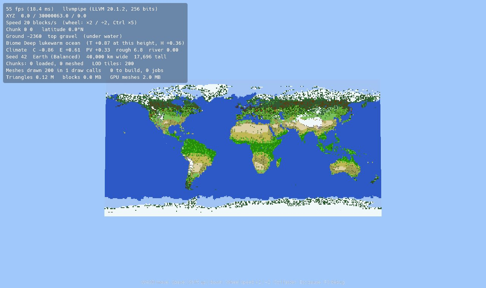
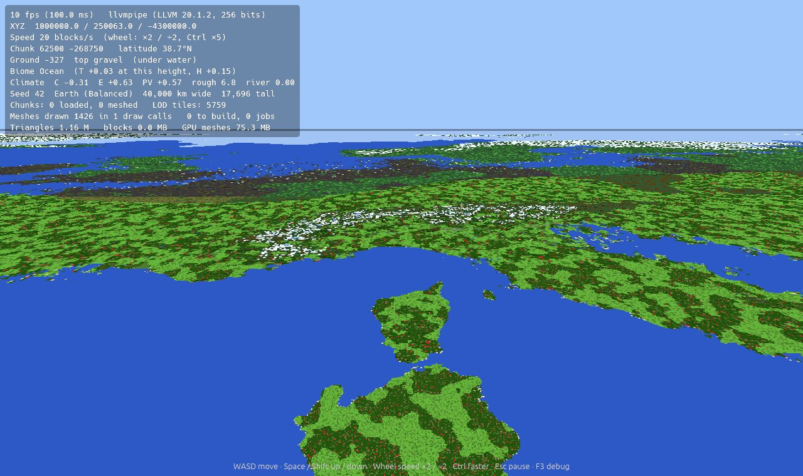

# Devlog 06: The whole world at once

Step 6 makes the far view reach the whole world. From the ground you see
to the horizon, as before. Fly up and the view keeps going, up to orbit,
where the whole 40,000 km Earth or the full 60,000 km world fits on screen.
Flying up is not more expensive. It is cheaper.

## In plain words (no coding knowledge needed)

**What changed:**

- The **Settings** screen has a new **Whole world** box under *LOD
  distance*. When it is ticked, the simplified far terrain reaches the
  world border in every direction. The **Quality** graphics preset turns
  it on. Optimized and Balanced keep their shorter views.
- You can now fly up to "orbit". The ceiling used to be just above the
  highest mountain. Now it is as high as the world is wide, high enough to
  see all of it.
- The higher you fly, the less detail the game builds. From 250 km up you
  can't see a single block anyway, so the game skips blocks and nearby
  detail entirely. It draws the land below as coarse tiles, like it
  already did for land far away. This is why the whole planet from orbit
  costs only 200 tiles.
- Land you have already seen stays in the graphics card's memory for a
  while (up to 256 MB) after it goes out of view. Turning back, flying
  back, or diving down and climbing up again shows it instantly instead
  of building it again.
- Building far-away terrain is up to 2.5 times faster in Classic worlds,
  and the bookkeeping the game does every frame is 4 to 6 times faster.
  Both give exactly the same world as before; nothing looks different.

**How it works:** the far view is a grid of tiles that get bigger with
distance. Each time the distance doubles, the tiles double in size, so
going from "256 chunks" to "the whole world" adds only about 13 more rings
of tiles instead of millions of chunks. The new part is that "distance"
now also counts how high you are. Something right below you, 50 km down,
counts as 50 km away and is drawn like anything else 50 km away.

**What it costs** (60,000 km world, 3 worker threads, measured without a
graphics card):

| Where you are | Tiles | Graphics memory | Time to build |
|---|---|---|---|
| On the ground, whole world | 13,600 | 180–210 MB | 6 s (Realistic), 13 s (Classic) |
| 16 km up (1,000 chunks) | 9,300–9,700 | 110–170 MB | under 1 s more |
| 1,600 km up (100,000 chunks) | 3,700–4,000 | 40–80 MB | under 1 s more |
| Back on the ground | 13,600 | same | instant (all from memory) |

The nearby area always comes first, so you can play straight away while
the far rings fill in. A computer with more cores than this test machine
builds the rings faster.

**How we know it's right:** 111 automatic tests (75 generator, 36 game).
The new ones check that:

- the tiles cover the whole 60,000 km world exactly once, with no gaps and
  no overlaps, from the centre, from a corner and from orbit;
- from higher up there are never more tiles than from lower down, and no
  full-detail chunks once you are above the render distance;
- the memory cache frees the oldest meshes first when it is full, and
  flying back reuses cached meshes instead of rebuilding them;
- the faster terrain sampling gives exactly the same answer as before (the
  maps are byte-for-byte identical, and every column still matches its
  chunk).

**What's still open:** the frame rate on an RTX 2080 has to be checked on
real hardware. The whole-world view from the ground draws about 4 million
triangles. The cloud test machine has no graphics card, so it renders in
software at 10 frames per second.

---

## Technical log

### Quadtree reach (`game::lod`)

- `MAX_LEVEL` 13 → **22**. A level-22 tile is 2²² chunks (67 M blocks)
  with 4,194,304-block cells, more than the 59,999,968-block world. All
  coordinates still fit in `i32`: the largest origin is −67 M blocks.
  Vertex positions are cell indices × `draw.w` (the cell size, a power
  of two, exact in `f32`). The camera-relative offset loses precision only
  at tens of millions of blocks away, where cells are 2¹⁵ blocks and more.
- `Layout { detail, lod, altitude }`. **`detail_dist(n) = max(chebyshev
  distance, altitude)`** decides splitting. `wanted` (pruning beyond the
  LOD distance) still uses the horizontal distance. Since `max(d, a)` is
  still 1-Lipschitz in the node position, leaves stay gap-free and
  neighbours still differ by at most one level (tested at 5 altitudes).
  Above the render distance level-1 nodes never split, so no chunks are
  generated at all.
- `GameSettings.whole_world` (serde default `false`, so old
  `settings.ron` files load unchanged). `layout(scale, world_chunks,
  altitude)` sets `lod = world_chunks` (the longer side), so the opposite
  corner is in range even from a corner. The Quality preset is now
  (24, 256, whole world).
- The camera's altitude is `(camera.y − water_top under the camera) / 16`,
  quantized to its 4 leading bits (`quantize_altitude`). Climbing then
  changes the layout every ~6 % of the height, not every 16 blocks.
- The camera ceiling is `max(max_y + 200, world width)`.

Leaves of the 60,000 km world (`whole_world_fits_in_a_few_thousand_tiles`,
render distance 12):

| Camera | Leaves |
|---|---|
| Centre, ground | 13,602 (676 chunks + 12,926 tiles) |
| Corner, ground | 4,090 |
| Centre, 1,000 chunks up | 9,348 |
| Centre, 100,000 chunks up | 3,972 |
| Centre, 3,000,000 chunks up | 256 |

Every chunk of the world is covered exactly once: the sum of clipped leaf
areas equals 3,749,998² chunks.

### GPU mesh cache (`game::world`)

When a mesh is neither a leaf nor drawn, the streamer used to send
`Remove`. Now it goes into an LRU (`cached: key → tick`, `lru: tick →
key`, byte total from `sizes`). The renderer keeps it in its pool but
doesn't draw it. The streamer sends `Remove` only when the cache exceeds
`CACHE_BYTES` = 256 MiB, oldest first. A wanted leaf found in the cache
becomes ready at once (`uncache`), with no job and no upload. Empty
meshes are just forgotten. Ranges are still freed only after the frames
in flight finish, as before.

### Per-frame bookkeeping

Measured on the whole-world quadtree (15,000 leaves) in an ignored timing
test (since removed):

| Operation | Before | After |
|---|---|---|
| `leaves()` (on view change) | 3.5 ms | 1.2 ms |
| `draw_set()` (when meshes arrive) | 2.1 ms | 0.33 ms |
| pending scan (every frame) | 0.5 ms | 0.05 ms |

- `FastHasher` (FxHash-style multiply–rotate) for every `NodeKey` and
  `ChunkPos` set and map. SipHash's protection against chosen keys is
  useless here.
- `draw_set` appends into one `Vec` and truncates on fallback, instead of
  returning a new `Vec` per node.
- `leaves()` sorts by one packed `u128` key (distance, level, z, x with
  the sign bit flipped) with `sort_unstable`. The keys are unique, so the
  order is unchanged.
- Uploads per frame: up to 128 meshes (was 48) and at most 16 MiB.
- Jobs in flight: 8 per worker (was 3). Realistic tiles take ~1 ms, so
  with 3 per worker the workers sat idle between frames.

Average `update()` time while building the whole-world view went from
2.8–4.3 ms to 0.7–0.9 ms. Time to complete the view went from 18.9 to
12.8 s (Classic) and from 21.3 to 5.9 s (Realistic Earth).

### Faster column sampling (`WorldGenerator::sample_column`)

Profiling a tile (callgrind) showed that 45 % of `lod_grid` was the 3D
density corners in `sample_column` and 36 % the climate/shape noise. Two
changes, both bit-identical:

1. **Zero-weight corners.** A column on the 4-block noise grid (`fx = 0`
   or `fz = 0`) gives the +x / +z corners weight 0. They are now copied
   from the near corners instead of computed:
   `c + 0·(c' − c) = c` exactly. Every LOD cell of 8 blocks or more is
   sampled on the grid.
2. **Shared cell corners.** Scanning down, the bottom corners of one
   noise cell are the top corners of the next one. They were computed
   twice; now they are kept.

Check: Classic maps (normal and 17,696 tall, several extents and layers)
are byte-identical to the previous build, and every column still matches
its generated chunk (`column_sample_matches_generated_chunk`, LOD
1-block test).

Tile generation, ms per tile on one thread (`wg-map --bench 32`, seed 42,
40,000 km; runs vary by ±15 %):

| World | Level 1 | Level 3 | Level 4 | Level 6 | Level 8 |
|---|---|---|---|---|---|
| Classic 384, before | 3.19 | 3.43 | 3.52 | 3.32 | 3.91 |
| Classic 384, after | 3.11 | 1.97 | 1.64 | 1.98 | 2.39 |
| Classic 17,696, before | 4.32 | 6.33 | 3.86 | 3.33 | 2.93 |
| Classic 17,696, after | 2.60 | 2.15 | 1.37 | 1.47 | 1.72 |
| Realistic Earth, after | 0.89 | 1.78 | 0.97 | 1.16 | 0.93 |

Chunk generation is unchanged: 0.9 ms (Classic 384), 3.6 ms (Classic
17,696), 0.6 ms (Realistic). It already shares its corners in a 5 × n × 5
grid.

**Tried and dropped:** replacing `f64::floor` in the Perlin noise with an
integer-truncation floor. Callgrind counted the library `floor` as 15 % of
instructions, but wall-clock time didn't improve (slightly worse with a
branch, equal without), so the change was reverted.

### In game (lavapipe, software rendering, 4 cores)

| View | Tiles | Drawn | Triangles | GPU memory |
|---|---|---|---|---|
| Orbit, 30,000 km up, Earth | 200 | 200 | 0.12 M | 2 MB |
| 250 km up, Europe | 5,759 | 1,426 | 1.16 M | 75 MB |
| 2.5 km above the Himalaya | 10,968 | 3,363 | 4.13 M | 243 MB |

All in one indirect draw call (two when a second vertex pool is in use).
The Khronos validation layer (`WG_VALIDATION=1`) reports no errors.

### Tests

- `lod::altitude_coarsens_the_view_without_gaps`: coverage, ±1 level
  between neighbours, monotone leaf count, no chunks above the render
  distance.
- `lod::whole_world_fits_in_a_few_thousand_tiles`: exact coverage of the
  60,000 km world from 5 camera positions, under 20,000 leaves on the
  ground, under 300 from orbit.
- `world::cache_frees_the_oldest_meshes_beyond_its_budget`, and
  `lod_rings_stream_swap_and_evict` now also checks that flying back is
  served mostly from the cache.
- `config::whole_world_reaches_across_the_world`, including old settings
  files.
- `world::whole_world_view` (ignored, a benchmark): `cargo test --release
  -p game whole_world_view -- --ignored --nocapture`.

### Known limitations

- RTX 2080 frame rate still to be measured. The worst case is the
  whole-world view near the ground: ~13,600 tiles, ~200 MB of vertices,
  about a third of them in the view frustum.
- Detail is chosen by distance only: about 2.5–5 pixels per cell at
  1080p, the same as the step 4 rings. A screen-space error metric (finer
  tiles where the terrain is steep) could look sharper for the same cost.
- The world is flat, so the far edge of the world shows as a thin band on
  the horizon instead of curving away.
