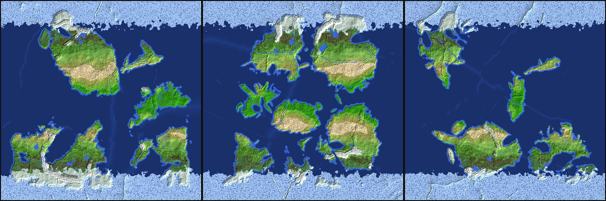
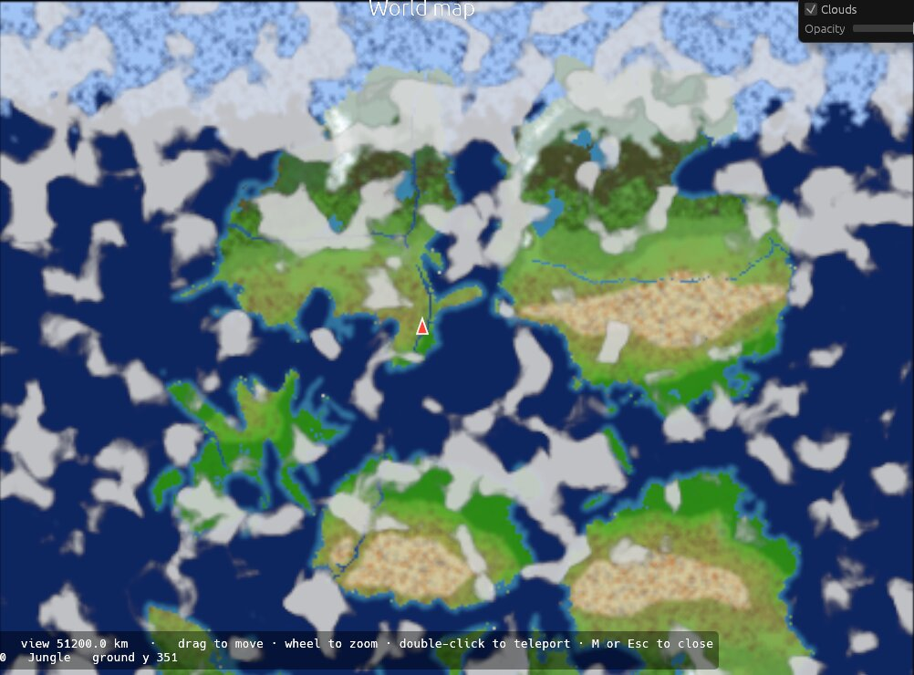
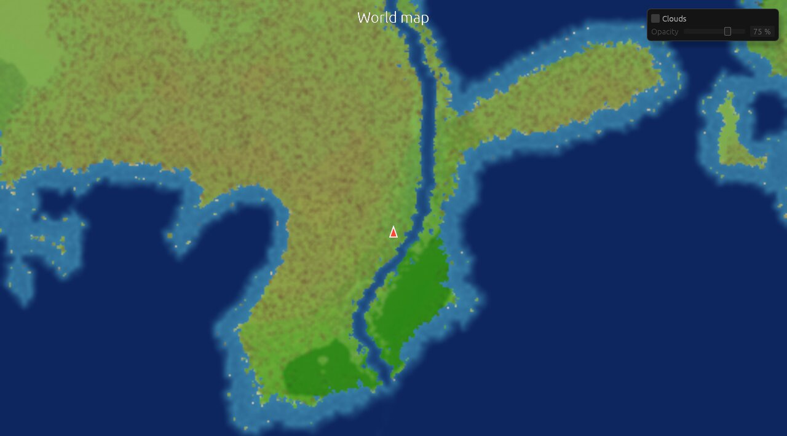
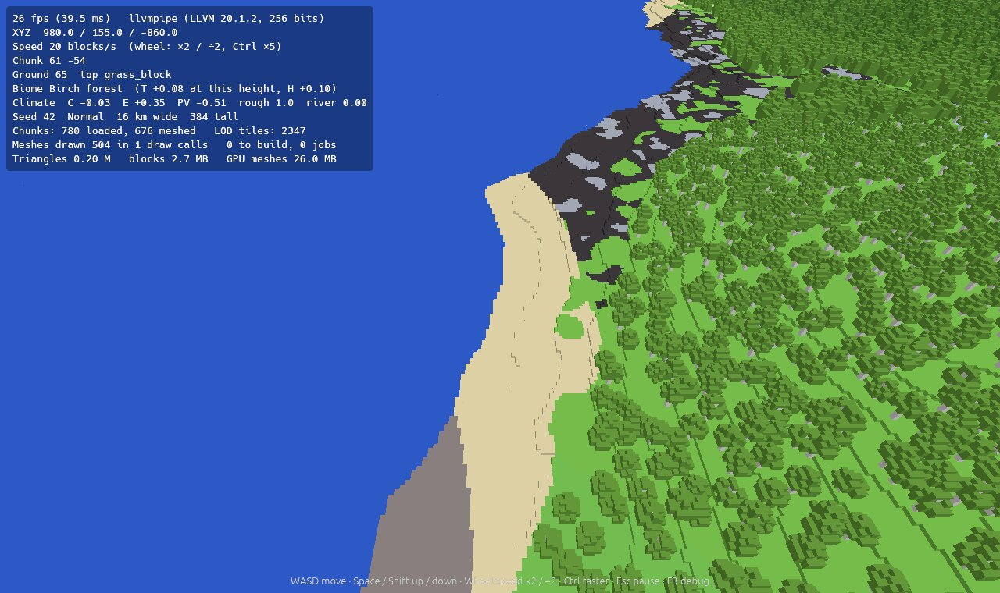

# Devlog 07: Wilder continents, real coasts and a map like a satellite photo

Step 7 is a round of fixes and variety requested after playing step 6.
Continents now have peninsulas, gulfs, inland seas and islands, and a
planet usually has 4 to 8 of them. Beaches come in five kinds. Biomes have
sub-biomes. Grass colour changes gradually from one biome to the next. The
world map looks like a photo from orbit and can show clouds.

## In plain words (no coding knowledge needed)

**What changed:**

- **No more "walls" in the sea.** Along some coasts the water used to stop
  in long straight lines, with dry land below sea level behind them. This
  was a bug in how dry hollows near the sea (like the Dead Sea) were
  handled. It is fixed. Such hollows now always have a natural rim of land
  between them and the sea.
- **Longer far view.** The *LOD distance* slider now goes up to 262,144
  chunks (256k) instead of 256. The slider is logarithmic, so small and
  huge values are both easy to pick.
- **Random seed button.** *Create world* has a **Random** button next to
  the seed box.
- **Continents with character.** A Continents planet used to have one or
  two big round blobs most of the time. Now each planet gets 4 to 7
  continents spread across the globe. Each one has a personality
  borrowed from Earth:
  - *massive*, like Africa or South America: big and compact, with smooth
    coasts;
  - *cordillera*, like western North America from Alaska to Baja
    California: long and bent, with a thin peninsula or two, a gulf, and
    islands offshore;
  - *fragmented*, like Europe: many peninsulas, inland seas and islands,
    and a very jagged coast;
  - *island continent*, like Australia: compact, with a deep bay, a cape
    and an island across a strait.

  Continents keep a sea between them, except for the occasional land
  bridge (like Panama). Over 30 test seeds, a planet has 4 to 9
  continents (Earth has 5 at the same scale) and the largest one holds
  about a third of the land, like Asia.
- **Five kinds of beach**, each where it occurs on Earth:
  - **shingle beaches** (gravel and boulders) on cool, stormy coasts, like
    Britain or Norway;
  - **tropical beaches** of white coral sand in the humid tropics;
  - **tidal flats**: mud, clay and salt marsh on flat, humid coasts, like
    the Wadden Sea;
  - **coastal dunes**: wide belts of sand with patches of dune grass behind
    flat, dry coasts, reaching a few blocks higher than a beach;
  - the ordinary sandy **beach** elsewhere. Rocky shores, fjords, mangroves,
    snowy beaches and salt flats are still there.
- **Sub-biomes:** **rocky desert** (gravel, stone and red sand) beside the
  sandy deserts; **bogs** (mud, peat and a few spruces) in flat, wet taiga;
  **flooded jungle** (mud and mangroves under the jungle) on flat, wet
  tropical lowlands; **heather moorland** on wet, cool uplands. That makes
  56 biomes.
- **Soft colour transitions.** Grass and oak leaves used to have one
  colour per biome. Wherever the biome changed, the colour jumped. Now
  the colour follows the climate (warmth and rain) smoothly, like on a
  satellite photo. Deep inside a biome it looks as before. At the borders
  it fades gradually. This works both in the world and on the map.
- **The world map looks like a photo from orbit.**
  - Forests show their dark green treetops, not the brown forest floor
    under them.
  - Biome borders are softened.
  - Mountains are lit from the north-west, so you can see the relief.
  - Shallow seas are turquoise and deep oceans dark blue.
- **Clouds on the map.** The map's top-right corner has a **Clouds**
  switch and an **Opacity** slider. There are more clouds where the
  climate is wet (rainforests, oceans) and fewer over deserts. Clouds
  are only on the map for now. Clouds in the world come later.

## Technical log

### 1. Coasts cut off in straight lines

**Symptom:** rectangles of dry land below sea level along coasts.

**Cause:** `RealisticWorld::shape` dried a column below sea level when the
cell's *sea* mask was below 0.5. That mask was sampled on the unwarped
grid point while the terrain used the warped one. On top of that, a
bilinear 0/1 mask draws its 0.5 contour as straight segments between
cell centres.

**Fix, in two parts:**

1. A separate `basin` grid marks land below sea level that is cut off from
   the open sea (`!sea && elevation < 0`). It is sampled through the same
   warp as the terrain. With 8-connected sea flooding, a basin cell never
   touches a sea cell, so its 0.5 contour always lies inland.
2. The block terrain between grid cells could still dip below sea level
   across that contour. So the basin gets a **rim**: for basin mask values
   in 0.25–0.65, the land is lifted to `SEA_LEVEL + 1`. The sea and a dry
   depression can therefore never touch.

**Test:** `coasts_never_hold_back_the_sea` covers Continents, Islands and
Earth. It samples 700² columns and takes every dry column below sea level
within a cell of the open sea. From each one it marches up to two cells
in 8 directions. Reaching water at sea level before land at or above it
counts as a wall. Results: 147 walls before the fix, 1 after part 1, 0
after part 2.

### 2. LOD distance up to 262,144 chunks

- `MAX_LOD_DISTANCE = 262_144`, and the settings slider is logarithmic.
- `layout()` clamps the scaled distance to the world, so a huge value in
  a small world costs nothing.
- The Quality preset stays at 256 plus *Whole world*.

### 3. Planned continents (`tectonics::plan_continents`)

The old crust field was `max(1 − d/r)` over 5–7 random blobs, plus noise,
cut at a quantile so that 40 % of the surface was continental. Blobs
overlapped and merged, so most seeds had one dominant landmass.

**Measuring it.** `LandShape` (in `tectonics.rs`) flood-fills landmasses
and reports four numbers: the continent count (masses ≥ 2 % of the land),
the coast index (coast cells / √area, where a disc scores ≈ 3.5), the
island share and the largest mass. The `continent_stats` example prints
them for Earth (ETOPO, averaged to the same 52 km cells) and for any
seeds:

| | continents | largest mass | coast index | land |
|---|---|---|---|---|
| Earth | 5 | 40 % | 8.9 | 29 % (equal-area) |
| Before, seeds 1–12 | 2–6 (often 2) | 45–94 % | 9.3 | ~38 % |
| Now, seeds 1–12 | 4–8 | 28–41 % | 7–10 | 16–29 % |

**The plan.** For each continent:

- K = 4–7 centres, placed with best-candidate sampling (12 candidates
  each) in the middle 66 % of the map.
- Each continent gets one of four characters. At least one is
  fragmented, at least one is a cordillera, and at most two are massive.
  The character sets the numbers below.
- **Body:** 1–6 ellipse lobes along a spine. Each lobe is smaller than the
  last (by the taper), has an aspect ratio of 1–2.3, and is oriented
  along the spine. At each step the spine tries three bends and takes the
  one heading furthest from the other centres.
- **Coast features** are placed at a point found by walking outward from
  a random lobe's rim until no lobe covers it (best of 6 tries):
  - **gulfs:** long water ellipses reaching inland from that point;
  - **peninsulas:** thin lobes reaching outward;
  - **islands:** small lobes a gap offshore.
- **Field of a continent:** `max(1 − d_lobe)` over its land lobes, then
  `min(·, 1.5·(d_gulf − 1))` over its water ellipses.

**Separating continents.** Each continent is clipped to its Voronoi cell
(around the plan centres), shrunk by a 260 km strait. Clipping alone
leaves straight coasts, so the plan is fitted first:

- Each continent's scale limit is computed analytically. It is the
  largest scale at which every body rim point stays a strait away from
  each bisector and inside 7–93 % of the map. Rim points move linearly
  with the scale, so this is a division per point.
- A bisection on a global scale (capped per continent by those limits)
  hits 36 % planned coverage on a 128² grid.
- Peninsulas and islands that still cross a bisector are shortened.

Earlier attempts fitted the shapes iteratively (shrink lobes, rescale, and
repeat), and they diverged. Land collapsed to 1–5 % because shrinking and
rescaling fought each other.

**Turning the plan into coasts.**

- Domain warp: 650 km, instead of 1,100 km, so the planned shapes survive.
- Per-continent ruggedness (0.15 massive to 1.0 fragmented), blended
  between continents with softmax weights (`exp(6 f)`). It sets an extra
  550 km·rug warp at 1,000 km wavelength, and noise weights
  `lerp(rug, 0.18, 0.3)` (5 octaves) and `lerp(rug, 0.05, 0.3)` (fine,
  4 octaves).
- Land bridges: a noise flips the strait margin to −260 km where it
  is > 0.35.
- The threshold is still the quantile, but clamped to ±0.15. An unclamped
  threshold drifted far below zero when the plan was small, and that
  merged everything.
- The border falloff is measured on the warped point, so it bends like a
  coast.

**Test:** `continents_are_many_separate_and_intricate` runs seeds 1–8 at
384². Each seed must have ≥ 3 continents, a largest mass < 70 %, land
12–40 % and a coast index > 5. The means must be ≥ 4.5 continents and a
largest mass < 50 %. Measured: 4–8 continents per seed, means 5.9 and
0.33.

Pangea, Islands and Earth are unchanged. The Continents planet changes
for every seed, which is the point of this step.

### 4. Climate-continuous grass tint (`worldgen::tint`)

`Tint(u8)` is a palette index:

- **Climate entries:** 13 temperature steps × 19 humidity steps = 247.
  The colour is a bilinear interpolation of a 5×5 table of control colours
  (frozen→hot × arid→very wet). The controls are the old biome grass
  colours of the biome that typically grows at each point.
- **Special entries:** 6 biomes keep a colour of their own: swamp,
  mangrove, mushroom fields, badlands, volcanic and moor.
- Temperature is the altitude-cooled `effective_temperature`, so mountain
  meadows get mountain colours.

The tint is stored per column:

- in `Chunk.tints`, `ColumnSample.tint` and `LodColumn.tint`;
- it replaces the biome in the mesher's merge key (`(tint + 1) << 8`) and
  in `block_color`;
- `sample_column`, chunks and LODs compute it with the same `Tint::of`, so
  they stay consistent.

Quantization keeps faces mergeable. Measured on 144 chunks of seed 42:
56,839 quads with tints, 56,661 with per-biome colours, and 56,603 with
one colour for everything (+0.3 %).

**Tests:**

- `palette_steps_are_small_and_span_the_biomes`: adjacent palette entries
  differ by ≤ 20 levels per channel.
- `grass_colour_blends_across_biome_borders`: 40 transects of 24 km on
  seed 42. Where the biome changes between two grass columns, the mean
  colour jump must be < 8 and under ⅓ of the old per-biome jump.

### 5. Satellite map (`game/src/map.rs`)

- `ColumnSample::orbit_color`: the ground colour, blended toward the
  canopy colour by canopy cover. `tint::canopy` derives both from the
  biome's tree mix (`trees::biome_trees`): chance × crown share per
  species (oak 0.9, spruce 0.6, jungle 1.0, bush 0.35, …) × 1.3, capped
  at 0.95. Leaf colours are weighted by crown. `wg-map`'s surface layer
  uses it too.
- **Blending:** a 3×3 average (centre weighted ×2) over neighbours of the
  same kind: land with land, sea and pack ice with sea. Coasts stay sharp
  and sea-ice speckle smooths out.
- **Hill shading:** `h(down-right) − h(up-left)` over 2.83 px, exaggerated
  by `0.875·√(bpp/16)/vscale`, clamped to 0.6–1.4.
- **Water:** `lerp(√depth)` from (62,140,178) to (14,38,96).
- **Clouds:**
  - A separate RGBA texture (LINEAR filtered), drawn with a white tint
    whose alpha is the opacity. Changing the opacity costs nothing.
  - fBm from 2,000 km wavelength down to 1 px (persistence 0.7), warped
    by 800 km.
  - Cut so that a share `0.36 + 0.4·humidity` of the sky is cloudy.
  - `MapClouds { show, opacity }` lives in `GameSettings`, defaults to
    on at 75 %, and is saved when the map closes.
- `WG_MAP_ZOOM=<blocks per point>` sets the map's zoom (for screenshots).

### 6. Beaches and sub-biomes

These are added to `biome::select`, `surface_for`, `trees::biome_trees`
and the biome table. One new block: `WHITE_SAND`.

| Biome | Where | Ground |
|---|---|---|
| shingle_beach | Cold coasts, or Temperate Wet/VeryWet, w > −0.15 | gravel, boulders, some sand |
| tropical_beach | Warm/Hot, Medium–VeryWet, w > −0.35 | white sand |
| tidal_flats | Temperate Medium+, e > 0.35, w < −0.2 | mud, clay, salt-marsh grass |
| coastal_dunes | Arid–Medium, e > 0.15, w < 0.05; up to 7 blocks above the water | sand, dune grass |
| rocky_desert | Warm/Hot Arid, w < −0.35 | gravel, stone, red sand |
| bog | Cold Medium/Wet, e > 0.3, low, w > 0.2 | podzol, mud, grass, sparse spruce |
| moor | Cold/Temperate Wet+, 30–55 blocks up, w < −0.25 | heather-tinted grass, coarse dirt, stone |
| flooded_jungle | Hot Wet+, swampy, w > 0.15 | mud, jungle and mangrove trees |

Shares measured on seed 42 (Classic, 48 km):

- shingle beach 0.9 %, beach 1.1 %, tropical beach 0.5 %, dunes 0.3 %,
  tidal flats 0.06 %;
- bog 0.75 %, moor 0.7 %, rocky desert 0.4 %.

The bog and flooded-jungle rules first covered most of the Realistic
lowlands. Realistic erosion is high on all plains, so they were tied to
weirdness patches as well. Realistic seed 3 now has bog 0.6 % against
taiga plus old-growth taiga 2.4 %, and flooded jungle 0.4 % against
jungle 1.9 %. Every biome is still reachable (`biomes_fit_their_terrain_and_all_occur`).

### Tests and checks

- `cargo test`: 115 tests pass (worldgen 79, game 36).
- `cargo clippy --all-targets`: no warnings.
- Lavapipe runs with `WG_VALIDATION=1`: no validation errors.
