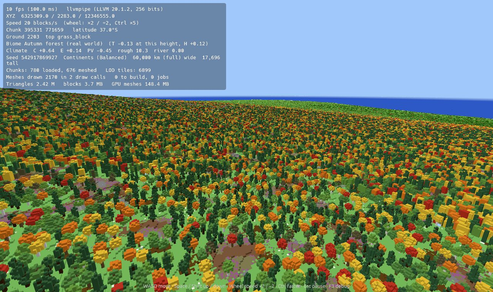
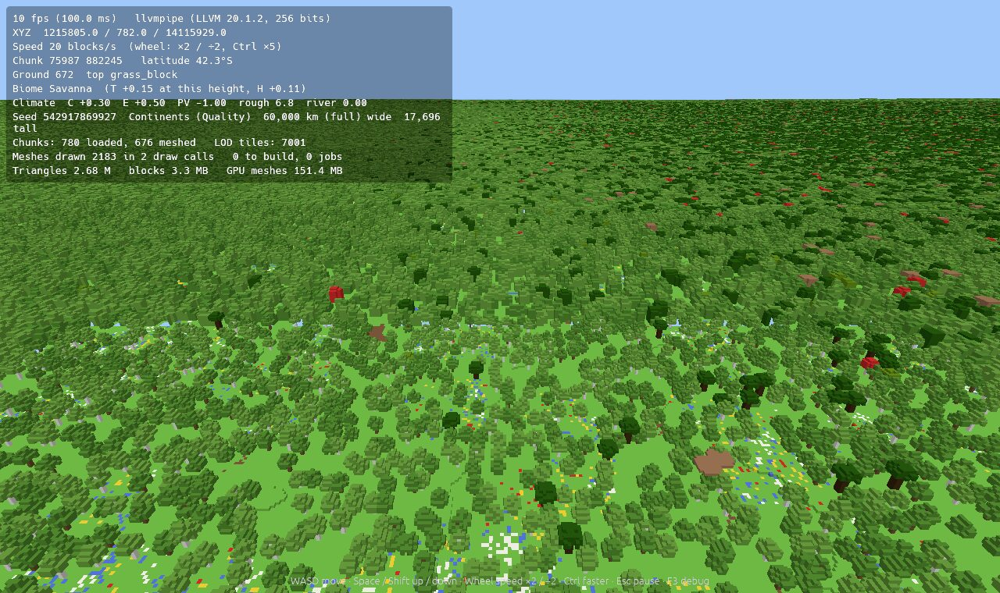
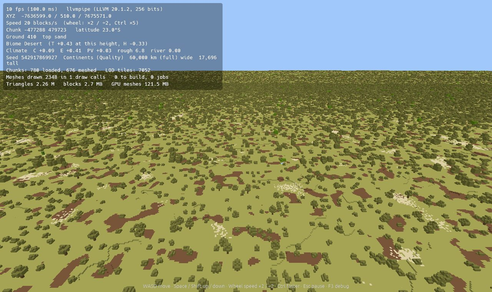
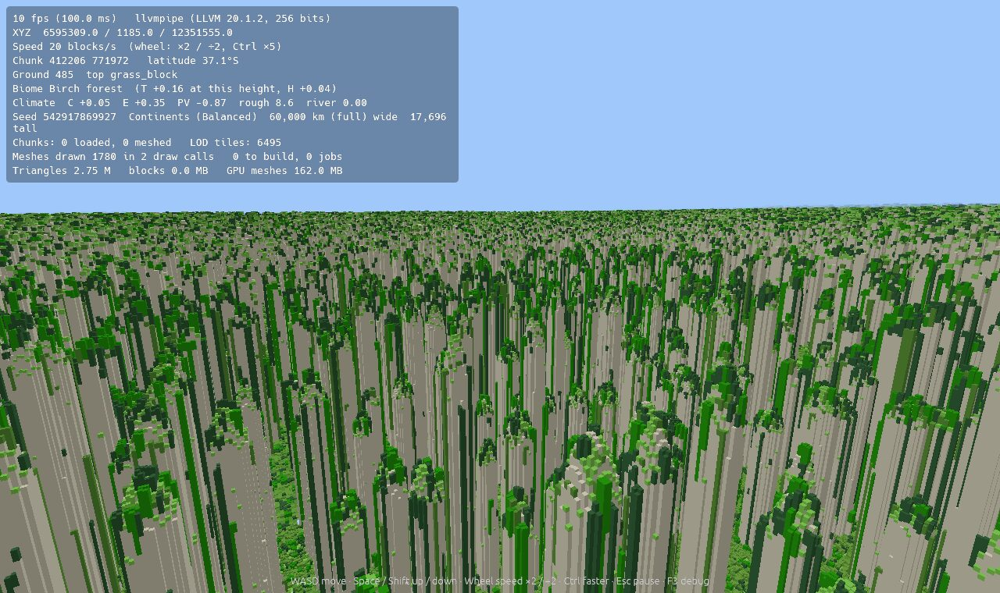
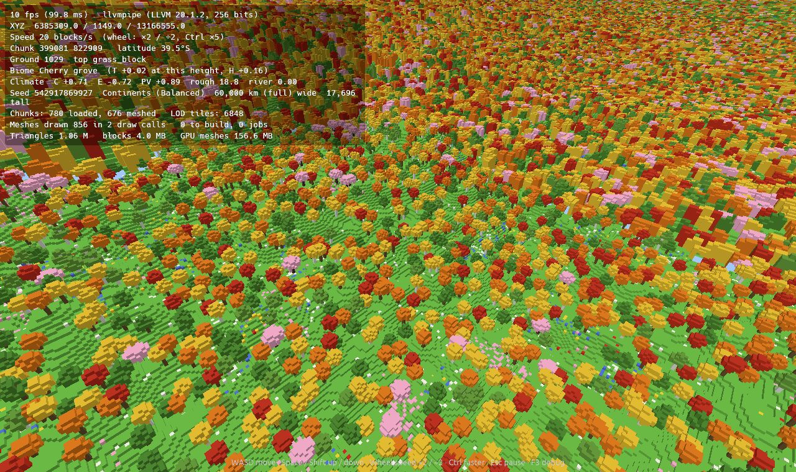
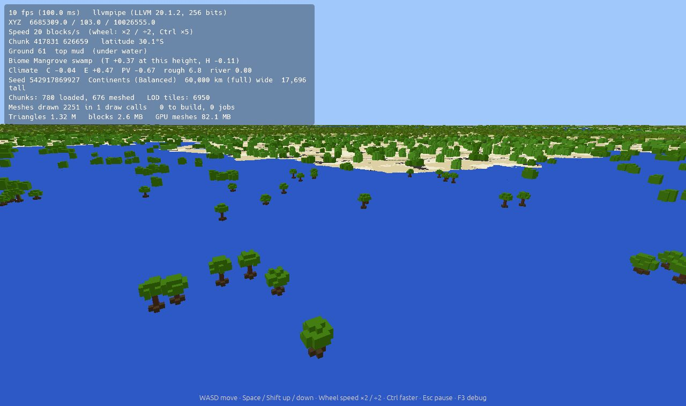
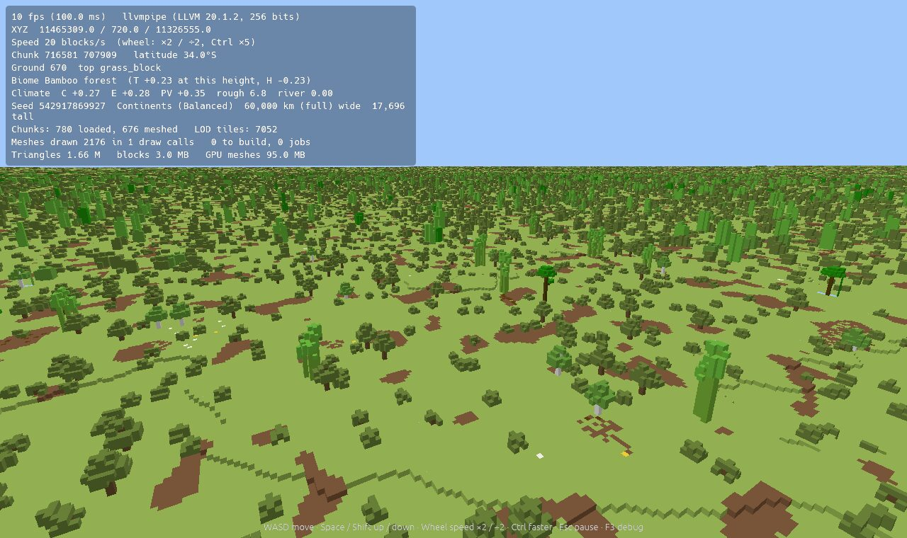
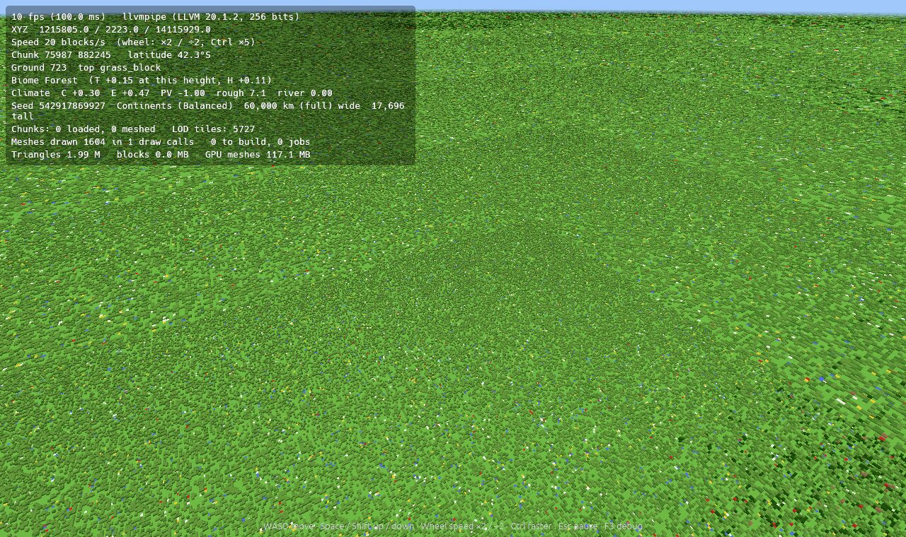
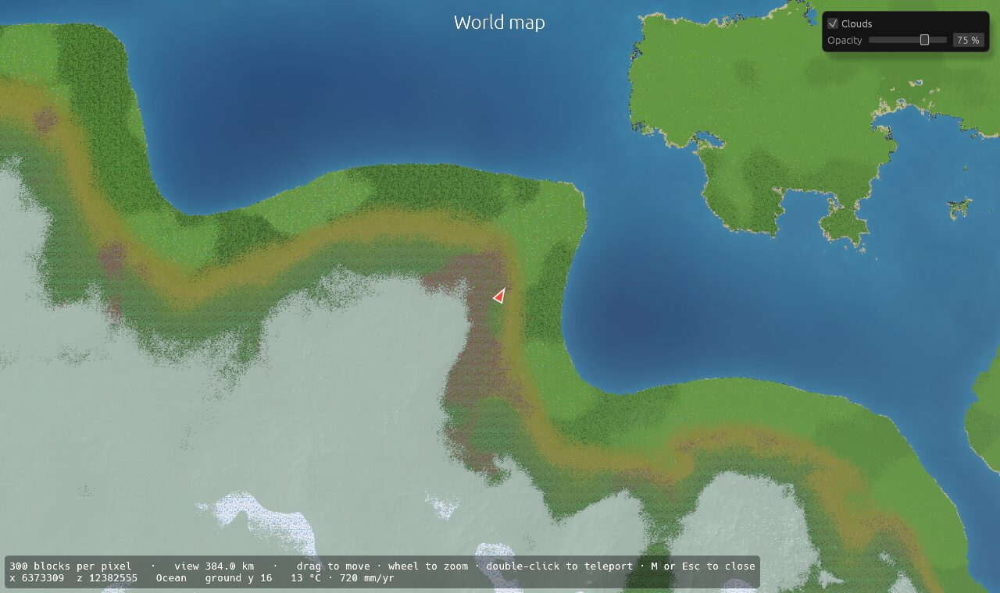
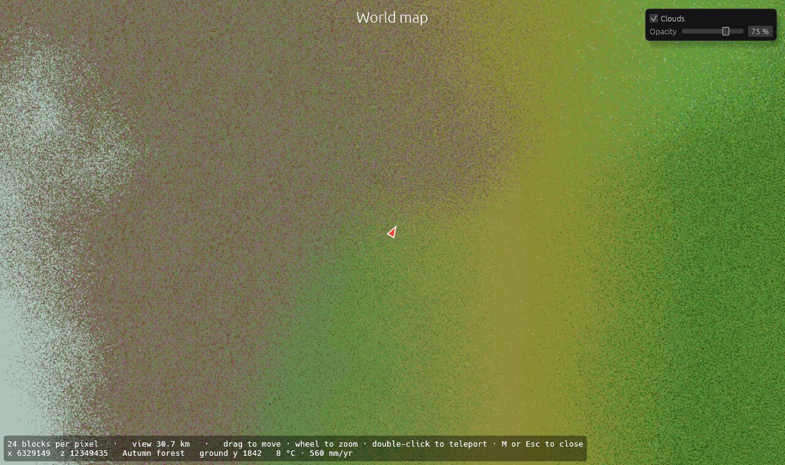

# Devlog 08: Biome transitions, a climate-chart biome system and regional landscapes

Step 8 answers four complaints after playing step 7: biome borders were
hard lines (close up, from high above and on the map), the world map looked
blurry, there were too few biomes (and no mangroves to be found), and
biomes did not follow rainfall, humidity and latitude closely enough. The
reference was the *Planet Architect* series by Devote; the videos
themselves could not be opened from the build machine, so the techniques
come from Devote's technical write-ups on the same project (biome
simulation, vegetation simulation, spherical Voronoi with smooth
boundaries), credited below.



## In plain words (no coding knowledge needed)

**What changed:**

- **No more hard borders between biomes.** Where one biome meets another
  there is now a wide transition zone where both are mixed in patches.
  Near biome A you mostly see A, in the middle it is half and half, and
  near B you mostly see B. This holds for every pair of biomes, from desert
  and savanna to two kinds of forest.
- **Trees mix too.** In a zone between an oak forest and a spruce forest,
  oaks and spruces grow side by side, alone and in small groves. The share
  of each kind follows how close you are to each side.
- **Seen from high up**, the far landscape no longer changes colour in
  straight lines. Forests used to look darker close to you than far away,
  because the far view painted a whole patch green if a single leaf was in
  it. Now it shows trees in the same proportion as the real forest.
- **A sharp world map.** The map is now drawn in tiles that are generated
  for the zoom you are looking at, so it stays sharp when you zoom in
  (before, it stretched a coarse picture). Clouds fade away as you zoom in,
  as if you had dropped below them; they were part of the hazy look.
  Moving the mouse over the map shows the biome, the temperature in °C and
  the yearly rainfall in mm.
- **Biomes follow the climate like on Earth.** Every biome sits on a chart
  of temperature (from the poles to the equator) against rainfall, like
  the charts ecologists use. Ice sheets at the poles, tundra, taiga,
  mixed and autumn forests in the cool middle latitudes, steppe and
  desert where it is dry, chaparral in hot dry summers, savanna, dry
  tropical forest and rainforest near the equator. High mountains cool
  down with height, so a tropical mountain has cloud forest and páramo
  above its jungle.
- **15 new biomes**, 71 in total:
  - **everywhere the climate fits:** mangrove swamps (warm, flat coasts and
    estuaries, trees standing in the water), autumn forest (maples in red,
    orange and yellow), mixed forest, flower plains, thorn scrub, dry
    tropical forest, páramo (tropical mountain grassland) and ice sheet;
  - **regional landscapes**, which exist only in a few places on a planet,
    like on Earth:
    - pillar forest: sandstone towers covered in forest, like Zhangjiajie
      or Guilin in China;
    - cherry grove (Japan);
    - baobab savanna (Madagascar);
    - redwood forest (California);
    - bamboo forest (China, Japan);
    - red-sand outback (Australia);
    - salt pans (Salar de Uyuni);
    - lavender fields (Provence).
- **Flowers.** Plains, meadows, flower forests and flower plains have
  poppies, dandelions, cornflowers and daisies; moors have heather;
  cherry groves have pink petals.
- **New trees.** Maple (red, orange or yellow), autumn birch, cherry, palm
  (on tropical beaches), baobab, giant redwood and bamboo.

**What you'll notice:** existing seeds keep their terrain, but their
biomes change: borders move a little and new biomes appear. Bioluminescent
beaches were left out on purpose, as asked.

**Try it:** the screenshots below come from the Continents planet of seed
`542917869927` (60,000 km wide, 17,696 tall). Use `find_biome` to jump to
any biome:

```sh
cargo run --release -p worldgen --example find_biome -- 542917869927 bamboo_forest 17696 continents
```

## Screenshots

| | |
|---|---|
|  |  |
| Transition at 42° S: forest, flower forest and savanna interleave over kilometres, oaks and acacias mixed. | Desert into thorn scrub at 23° S: bushes thin out gradually, no line. |
|  |  |
| A pillar forest region (far view). | A cherry grove region next to an autumn forest. |
|  |  |
| Mangroves standing in a warm shallow bay at 30° S. | The edge of a bamboo forest region mixing into birch forest. |
|  |  |
| From 1,500 blocks up: no straight colour seams any more. | World map, 384 km wide: forest, autumn forest, mountains, clouds fading. |



## Technical log

### 1. Credits: what came from Devote's write-ups

Devote's *Planet Architect* posts describe:

- biomes as nearest **target points** in a temperature × precipitation
  chart (a Voronoi diagram of the Whittaker chart), several per biome;
- a **domain-warped Voronoi region map** with smoothly blended
  boundaries (quintic smoothstep of the distance to the cell edge);
- vegetation species chosen by **climate preference** rather than by biome
  label.

All three are here (sections 2–4), adapted to columns generated on demand
from a seed instead of a mesh simulated once. On top of that this step adds
dithered transitions with a linear probability profile, tree species that
dither independently, regional flavours, LOD canopy coverage and the tiled
map.

### 2. Climate-space classification (`biome::classify`)

`LOWLAND` lists target points `(temperature, humidity, biome)`.
Temperature is weighted 1.6× in the distance, because the temperature
range is narrower than the humidity range in our climate units. Polar
targets sit at temperatures only (ice sheet at −1.25, tundra and snowy
plains around −0.8): on a realistic planet humidity comes from aridity,
and cold air is "wet" by that measure, so humidity must not decide there.

After the nearest target:

- weirdness picks sister biomes (forest ↔ birch forest ↔ flower forest,
  plains ↔ flower plains, savanna ↔ sparse jungle);
- flat, waterlogged ground turns into swamp, bog or flooded jungle;
- the altitude step (before classification) uses `Shape::normalized_y`
  and the lapse rate: cloud forest and páramo above warm lowlands.

On a realistic planet `RealisticWorld::climate_at` turns the climate back
into °C and mm/yr (`climate::invert`, bisection on the forward curves) for
the map's hover line.

### 3. Dithered transitions (`biome::Jitter`, `BiomeDither`)

`select()` now calls `select_with(.., &Jitter)`. The jitter offsets
temperature (`DITHER_T` = 0.07), humidity (0.08), weirdness (0.16), the
altitude used by the mountain rules (7 blocks) and the region threshold.
It comes from two noises (2 octaves, wavelength 32 blocks, scaled ×2.6 and
clamped to ±1), so its distribution is close to uniform:

- **ground**: 0.8 patch noise + 0.2 per-column hash, so borders become
  interleaved patches with a little speckle;
- **trees** (`resolve_tree`): 0.5 patch + 0.5 per-tree hash, so species mix
  individually and in groves.

With a uniform offset, the probability that a column a distance *d* inside
biome A's side lands on A is ½ + *d*/(2·width): linear across the zone,
50/50 at the border. The width is in climate units, so on a realistic
planet, where climate changes over hundreds of km, the transition is tens of
km wide; in a classic world a few hundred blocks.

`examples/biome_stats` measures this: along rows, at every change of land
biome, does the previous biome return within 64 blocks?

| World | Changes | Return within 64 blocks |
|---|---|---|
| Classic, seed 42 (48 km) | 43,265 | 87 % |
| Continents, seed 542917869927 | 34,939 | 92 % |

Before this step borders were single lines, so this was close to 0 %.

Generator tests that checked climate bands were relaxed by the dither
width (hot > 0.08 instead of > 0.15, frozen < −0.35, summit rule −8 blocks).

### 4. Regions (`worldgen::region`)

A jittered grid of sites (cell 3,000 × scale blocks in classic, 6 grid cells
≈ 470 km on a realistic planet), each owning its Voronoi cell, with the
lookup domain-warped (2 octaves, 0.45 cell) so borders curve. A hash of the
site gives a flavour to about one region in three (`Flavour::SHARES`).

`strength` is the distance to the nearest Voronoi edge with a site of
*another flavour*, `(|PB|² − |PA|²) / 2|AB|`, through `smoothstep(0, 0.3)`.
The biome applies the region where `strength > jitter.region`, so a
regional landscape dissolves into its neighbours over 0.3 cell instead of
stopping on a line (test `regions_are_large_patches_with_soft_edges`).

`biome::regional` maps host biomes to the regional one (a temperate forest
becomes a cherry grove, a savanna a baobab savanna, …). A flavour whose
region has no fitting climate doesn't show, so regional biomes cover
0.07–0.8 % of the land each.

**Pillars** change the terrain. In a Pillars region, `raise_pillars` adds
height on a separate jittered grid (spacing 18·scale^0.4 blocks, radius
0.2–0.33 of it, so neighbours never merge): vertical walls for the outer
15 %, a slight dome on top, 35–90·√scale blocks tall, roughness cut by 80 %
so the 3D noise doesn't fray the walls. Density is 0.55 × a suitability
product (region strength, warm, humid, on land but not on beaches, below
100 default-world blocks, away from rivers). `Shape.pillar` is subtracted
again where height drives climate (biome altitude, tint), so a pillar's
top keeps the forest of its foot. LOD walls split into a top band and
rock below (`LodColumn::side`, from the new `ColumnSample::side_block`),
so the far pillars are grey towers with green tops, not green slabs.

### 5. Mangroves

Mangroves were possible before but nearly never chosen. Now
`mangrove = T > 0.4 && H > −0.12 && water == SEA_LEVEL && no island`, in
three forms: underwater columns in shallow warm bays, estuaries (river
mouths), and low flat coasts. Mangrove trees root in water.

### 6. LOD canopy coverage (`worldgen::lod`)

A far view showed straight seams where the LOD switched cell size:

| Cell size | Canopy share before | after |
|---|---|---|
| 1 (exact) | 0.378 | 0.378 |
| 4 | 0.788 | 0.390 |
| 8 | 0.976 | 0.394 |
| 16 | 0.517 | 0.419 |
| 64 | 0.511 | 0.414 |

(forest at 1215805, 14111000 on the planet above). Small cells
rasterised real trees and the highest block won, so one leaf painted the
whole cell; large cells showed the middle candidate whenever it grew.

Now a small cell records the columns its trees cover (a 64-bit mask,
cell² ≤ 64) and shows the canopy only if `covered / cell² > roll`, with
`roll` a uniform hash of the cell. Large cells do the same with the
tree's crown footprint over the tree-grid cell area. 1-block cells are
fully covered or not at all, so they stay exactly equal to chunks
(test unchanged); `coarse_canopy_matches_forest_density` now also checks
8-block cells.

### 7. Tiled world map (`game/src/map.rs`)

The map is a quadtree of 256-pixel tiles, level *k* at 2^*k* blocks per
pixel. Each frame picks the level for the zoom, asks a background worker for
missing tiles (the three coarsest preview levels first, then by distance
from the centre) and draws the best tile available, or the matching
sub-rectangle of an ancestor while waiting. 160 tiles are kept in an LRU.
Textures use nearest-neighbour magnification and the old blur pass is
gone: biome borders are now transitions in the generator itself.

Clouds fade with `smoothstep(ln 128, ln 1024, ln blocks_per_point)`: full
on a planet view, gone below 128 blocks per point.

### 8. New blocks, trees and flowers

Blocks 47–63: cherry log/leaves, red/orange/yellow leaves, palm leaves,
baobab and redwood logs, bamboo and bamboo leaves, and flower carpets
(poppies, dandelions, cornflowers, daisies, lavender, pink petals,
heather). `Block::is_flowers` and `is_grassy` let trees grow on flowers.
Tree kinds: maple, autumn birch, cherry, palm, baobab, redwood (2×2 trunk,
22–32 tall, `TREE_HEADROOM` 40) and bamboo clumps; all within
`TREE_REACH` (tested).

Flowers are a per-column noise × density test in `surface_for`, so chunks,
`sample_column` and LODs agree.

### Biome shares

Continents planet, seed 542917869927 (51,670 land samples): autumn forest
10.4 %, chaparral 10.1 %, snowy taiga 9.3 %, savanna 6.8 %, old-growth taiga
6.8 %, sparse jungle 5.8 %, mixed forest 5.7 %, forest 5.5 %, desert 4.4 %,
… regional: cherry grove 0.79 %, lavender 0.44 %, baobab 0.43 %, bamboo
0.32 %, outback 0.29 %, redwood 0.28 %, pillars 0.11 %, salt flats
0.07 %; mangroves 0.08 %, ice sheet 0.64 %. Every biome appears over 48 km
in a classic world (seed 42), including the regional ones (test).

### Performance

`wg-map --bench 8`, one thread, ms:

| | Chunk | LOD tile, cells 2 / 4 / 8 / 16 / 64 / 256 |
|---|---|---|
| Classic, before | 0.93 | 2.25 / 3.20 / 2.76 / 2.16 / 2.65 / 0.75 |
| Classic, now | 1.09 | 2.69 / 3.62 / 4.11 / 2.88 / 3.09 / 0.89 |
| Realistic, before | 0.62 | 0.83 / 1.20 / 2.04 / 1.04 / 1.13 / 1.26 |
| Realistic, now | 0.81 | 0.97 / 1.38 / 3.06 / 2.12 / 2.21 / 2.34 |

Generation is 15–40 % slower: the dither and region lookups per column,
the pillar grid, flowers and more tree work. It runs on worker threads, so
the frame rate is unaffected; chunks and tiles arrive a little later.
Noise octaves were trimmed to keep it there (dither 3 → 2, region warp
3 → 2, two realistic climate noises merged). Rendering cost is unchanged:
the same number of quads per mesh within noise.

### Tests and checks

- `cargo test`: 118 tests pass (worldgen 81, game 37).
- `cargo clippy --all-targets`: no warnings.
- Lavapipe runs with `WG_VALIDATION=1`: no validation errors in any
  screenshot run.
