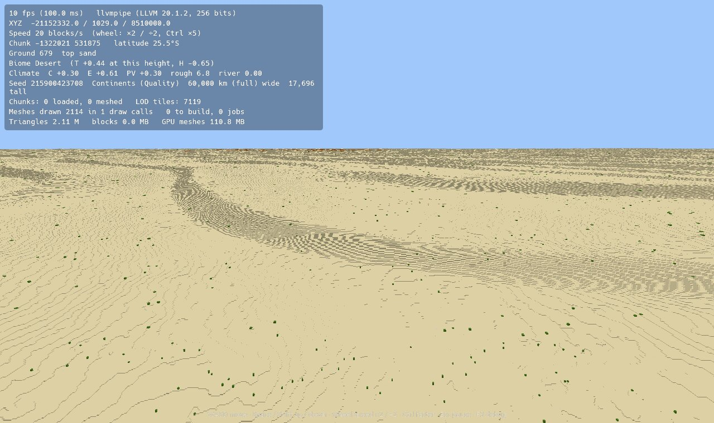
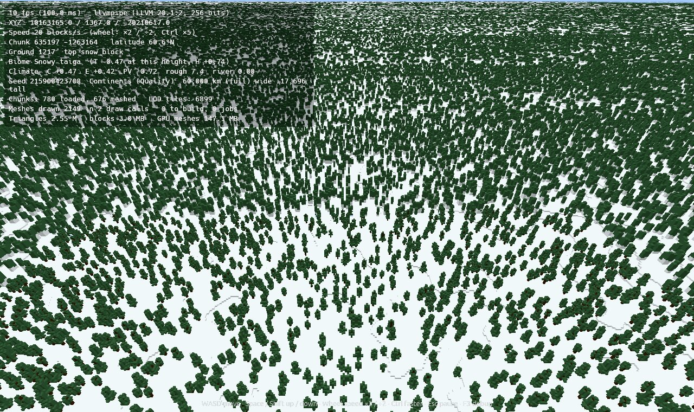
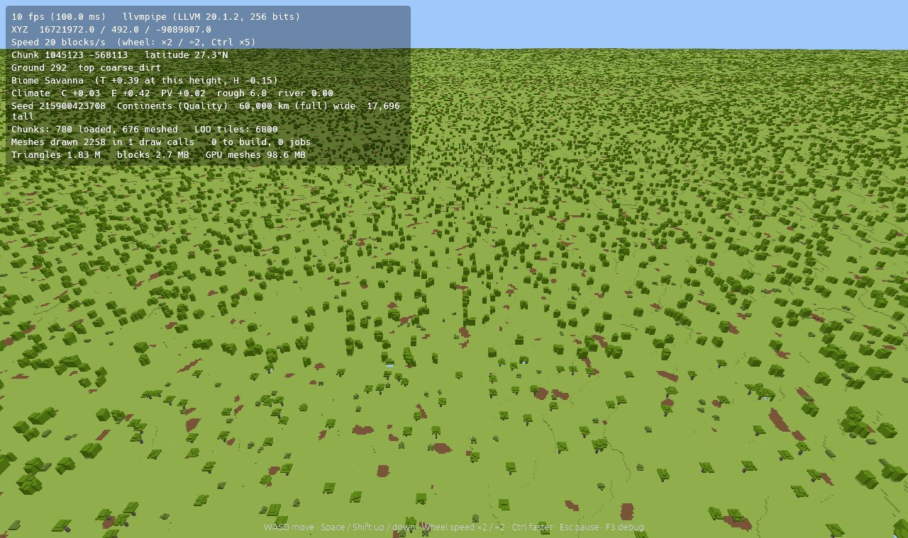
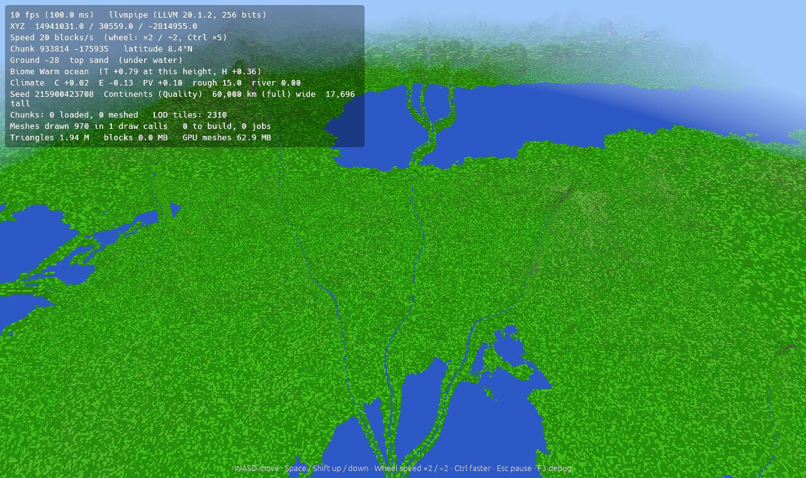
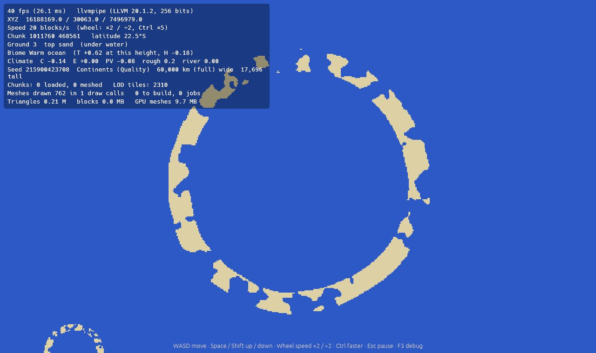
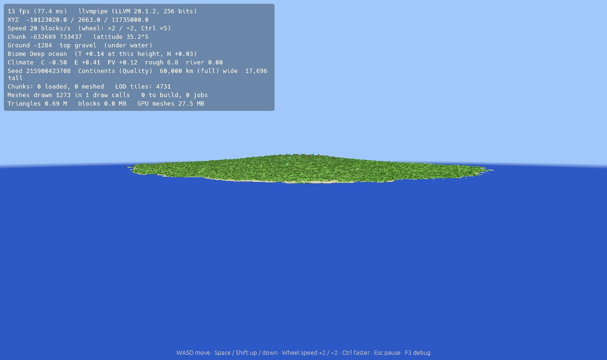
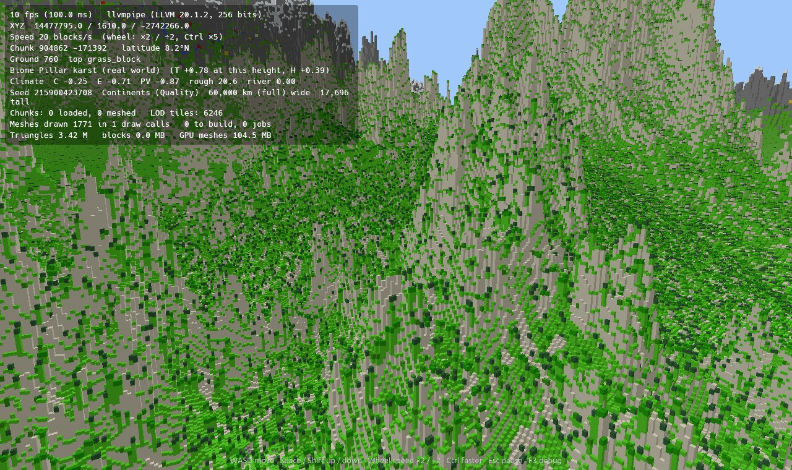
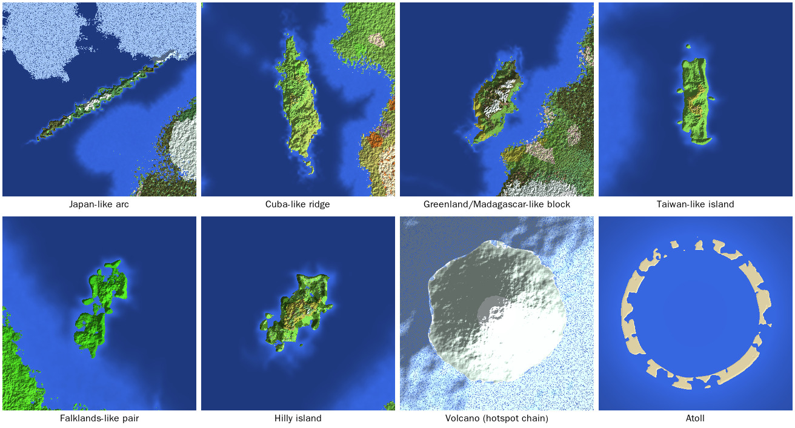
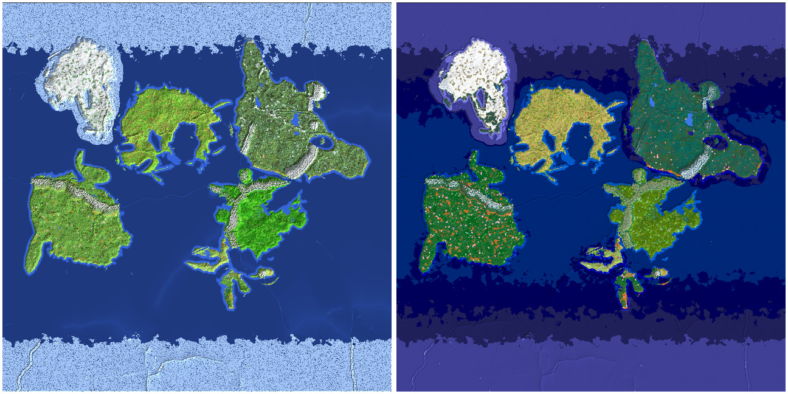

# Devlog 09: Pure biome cores, river networks, hills, island rounds and the Mushoku planet

Step 9 answers the feedback after playing step 8 on a Continents planet
(seed `215900423708`, Quality, 60,000 km × 17,696 blocks):

- the transition patches showed everywhere and repeated, even in the middle
  of a biome;
- some rivers crossed lakes as if they weren't there, stopped in the middle
  of nowhere, cut through each other, didn't join into networks, and were
  all about the same size;
- the pillar forest grew unnatural columns on a mountainside;
- the land had no hills away from the mountains;
- there were no islands of the sizes Earth has (Japan, Cuba, Taiwan, the
  Pacific atolls);
- and a new planet was asked for, **Mushoku**, where every continent has
  one dominant biome.

## In plain words (no coding knowledge needed)

**What changed:**

- **Biomes are pure in their heart.** The mixed patches now appear only
  near a border between two biomes. In the middle of a snowfield the
  ground is all snow, in the middle of a desert all sand. Some places are
  extra pure: a grassland that is only lawn, with few flowers. Borders
  vary too: some are wide belts where two biomes mix, others are almost a
  line. Seen from far away, the repeating pattern of patches is gone.
- **Rivers are networks.** Small streams start in the hills, join into
  bigger rivers, and those join a main river that reaches the sea or a
  lake. Rivers never cross each other, never stop in the middle of dry
  land, and end where they meet a lake instead of running across it. Their
  sizes range from creeks a few blocks wide to Amazon-sized rivers more
  than a kilometre wide.
- **No more pillar staircases.** Pillar forests (Zhangjiajie-style sandstone
  towers) now only grow on plains and in wide valleys, the remains of an
  old plateau. On a mountainside they used to look like a staircase of
  columns.
- **Hills, each with a reason.** Away from the big mountain ranges there
  are now:
  - foothills along the outside of a range;
  - old, worn-down ranges: long belts of rounded ridges a few hundred
    metres high (like the Appalachians or the Urals);
  - rolling hill country in some plains (like Tuscany);
  - sand seas in hot deserts: dune ridges tens of blocks high, lined up
    across the wind, with a gentle side and a steep side.

  Plenty of land stays flat: about a quarter of the lowlands are hilly.
- **Islands in rounds.** After the plates make the continents, three more
  rounds add islands:
  - **large islands** off the coasts: long volcanic arcs like Japan or
    Java, narrow ones like Cuba, broad blocks like Greenland, Madagascar or
    Great Britain;
  - **medium islands** with their own small mountain range along them,
    like Taiwan, Puerto Rico or Jamaica, and low hilly ones like the
    Falklands (sometimes two islands with a sound between);
  - **small islands of the open ocean**: chains of volcanoes (the youngest
    tall, the older ones worn into gentle hills, the oldest sunk into
    coral atolls, like Hawaii), clusters of atolls in warm seas (like the
    Marshall Islands or Tuvalu), and volcanic clusters in cooler seas (like
    the Azores). An atoll is a ring of white sand islets around a lagoon,
    only a couple of blocks above the sea.
- **New planet: Mushoku.** Each continent is ruled by one biome: a desert
  continent, a jungle continent, a taiga continent, a snow continent, a
  forest, a savanna, a grassland or a temperate rainforest continent. Each
  has two similar biomes in smaller areas (a desert has thorn scrub and dry
  savanna; a taiga has snowy taiga and old-growth taiga). Coasts and
  islands between two continents mix the two themes. A biome opposite to
  the theme never appears: no snow on a hot continent, not even on its
  mountains; no desert on a wet one; no jungle on a cold one. Choose it in
  *Create world → Realistic → Planet*.

**What you'll notice:** existing seeds keep their continents, but the
Realistic worlds get new islands, hills and many more rivers; the Classic
generator only gets the purer biome cores.

## Screenshots

| | |
|---|---|
|  |  |
| A snowy taiga at the spot of the first complaint: the ground is snow, the patches are gone. | Savanna: the ground is even, with occasional bare patches. |
|  |  |
| A river network: creeks join into a main river that ends in a lake. | An atoll in a coral archipelago. |
|  |  |
| A volcanic island of a hotspot chain, seen from the sea. | The pillar forest spot of the complaint: karst mountains, no stray columns. |

*Island rounds on the Continents planet (maps from `wg-map`): a Japan-like
arc, a Taiwan-like island with its own range and a Falklands-like pair, a
Greenland/Madagascar-like block, a volcano and an atoll.*

*Mushoku with the same seed (Quality), satellite view and biome map: the
same continents, now a frost continent (top left), a savanna (top middle),
a taiga (top right), a forest (bottom left) and a jungle (bottom right).*

## Technical log

### 1. Pure biome cores and varied transitions

The step 8 dither (`biome::Jitter`) offsets the climate by up to
`DITHER_T` = 0.07 and `DITHER_H` = 0.08 before the biome is chosen. That
width is in climate units, so its width in blocks is the dither divided by
the climate gradient. On a realistic planet the gradient is tiny (the
climate changes over thousands of km), so the "transition zone" was
hundreds of km wide and covered most of the land: the patches the user saw
in the middle of a snowy taiga were a zone between snowy taiga and snowy
plains.

- **Dither scaled by the gradient.** The realistic shaper builds
  `grad_t`, `grad_h` (biome units per km, central differences on the
  simulation grid) and adds the finer weather noise's own gradient
  (8e-4 / 9e-4 per km). `Shape::blend_t = min(1, 8 km · ∇T / DITHER_T)`,
  likewise `blend_h`: a zone reaches at most ~8 km to each side of a border.
  `biome::select_with` multiplies the jitter by them.
- **Character noise** (`generator.rs`, salt `biome/character`, ~1,000
  blocks in Classic, ~40 km on a planet) multiplies the blend by 0.1–1, so
  some borders are wide belts and others nearly lines, and sets
  `Shape::purity` (0..1): the ground patches (`patch_at`) are multiplied by
  `1 − purity` and flower density by `(1 − purity)²`. Where purity is high a
  plain is an unbroken lawn.
- **Coarse LOD sampling.** Far-view cells are sampled on a power-of-two
  lattice, which aliased the 16–32-block patch noise into a regular grid
  visible from high above (the "repetitive pattern"). For cells of 32
  blocks and more (`COARSE_CELL`) the biome comes from the per-column
  white noise only (`BiomeDither::ground_coarse` / `tree_coarse`), patches
  are 0 and flower kinds are picked by hash: `lod_grid` uses
  `sample_column_for_cell`.
- **Regions.** The rare-region edge (where a cherry grove or pillar forest
  fades into its host) was 0.3 of a Voronoi cell, ~100 km on a planet. It
  is now at most 10 km (`Regions::new(seed, cell, edge)`).
- **LOD walls** (game `lod.rs`): a far cell's wall used the canopy colour
  all the way down to the ground, so forests looked like green cliffs.
  Now only the top 6 blocks (`CROWN`) are canopy, then the ground block,
  then the rock band. Tree blocks overhanging more than `TREE_HEADROOM`
  (40) above a coarse cell's ground are skipped.

`biome_stats` now prints the share of land columns that take a
neighbour's biome: 9.4 % on Classic seed 42 (84 % of borders interleave),
3.8 % on the realistic planet (93 % interleave). Before, on the planet, it
was most of the land.

### 2. River networks

The rivers are the drainage tree of the flooded terrain (Priority-Flood,
Barnes et al. 2014). The bugs came from four places:

1. **Rivers across lakes.** A lake's cells were river nodes like any
   other. Now `build_rivers` skips reaches with both ends in a lake: a
   river ends at the shore and the outlet starts again at the rim. Inside
   standing water (`height < water`) no valley is carved and no banks are
   raised (`open_water`), which removed strips of land in lakes and at
   river mouths.
2. **Rivers that stop.** Terminal lakes were dropped when evaporation beat
   the inflow, leaving the river ending on dry land. `water_balance_lakes`
   now keeps at least a small lake (≥ 5 m deep) wherever a river of
   `q_min` or more flows in (Lake Eyre, Lake Chad), and `route_water`
   makes lakes that don't fill their hollow sinks: the dry slopes of the
   hollow drain into the lake (a flood from the lake over its hollow)
   instead of across to the rim the flood found.
3. **Rivers that cross.** In a square of four cells, flows along both
   diagonals cross. `route_water` sends the upstream end of one diagonal
   into a cell of the other that lies downstream of it (`pos[t] < pos[s]`
   in the topological order, so no loop can form; if neither of its cells
   qualifies, the other diagonal is rerouted). Node jitter inside a cell
   went from ±0.3 to ±0.2 cells: with ±0.3, two parallel diagonal
   neighbours could cross (they are 0.71 cells apart). Rivers meeting at
   the same sea cell share one mouth extension instead of splitting.
4. **Sizes.** `q_min` (the smallest river kept) went from 600/250/100 to
   150/40/12 m³/s (Fast/Balanced/Quality), and source nodes start at
   0.08 · `q_min`, so a river begins as a creek and widens downstream
   (channel width ≈ 4·Q^0.5 m, minimum 3 blocks). Flat ground (a filled
   basin or coastal plain) got a jittered flood key
   (`erosion::flat_jitter`), so rivers cross flats in natural curves
   instead of straight lines.

Levels are made monotonic in topological order (`Routing::level`), so a
river never climbs.

| Quality | reaches before | reaches now | largest river | < 100 m³/s | 100–1,000 | 1,000–20,000 | > 20,000 |
|---|---|---|---|---|---|---|---|
| Balanced | 6,240 | 31,393 | 209,772 m³/s | 5,367 | 18,634 | 6,473 | 919 |
| Quality | — | 120,008 | 111,017 m³/s | 78,407 | 27,258 | 12,429 | 1,914 |

(The Amazon carries ~210,000 m³/s; the Nile ~2,800.)

### 3. Pillars

`raise_pillars` multiplies the pillar suitability by
`smoothstep(−0.2, 0.15, erosion)`: pillars stand where the climate's
erosion value says plains or wide valleys, never on mountainsides, where
each column started lower than the last. At the reported spot
(14477795, −2742266, erosion −0.71) the pillars are gone and the karst
mountains remain.

### 4. Hills (`RealisticWorld::build_hills`, `hills`, `dunes`)

Three grids are computed once per planet:

- `hill_amp` (m): the largest of
  - **foothills**: 280 m × `smoothstep(0.02, 0.12, blur(mountain, 300 km))`,
  - **old ranges**: 420 m along the zero lines of a 2,600 km noise, gated
    by a second noise so belts start and end,
  - **rolling uplands**: 160 m where a 900 km noise is high;

  all × `1 − smoothstep(0.2, 0.5, mountain)` (not on the active ranges) and
  faded out within 40–160 km of the coast, so the shoreline never moves.
- `hill_ridge`: the old ranges' share, which makes the hill noise ridged.
- `dune_amp` (m): 80 m where the climate is hot (biome T > 0.15–0.3) and
  arid (H < −0.48…−0.62), in lowlands below 600–1,500 m, in patches of a
  700 km noise (an erg covers about a quarter of a hot desert, like the
  Sahara's sand seas).

Per column, `hills` sums 7 octaves from 8 km down to the block scale (each
octave turned by its own fixed angle: ridged Perlin otherwise shows its
lattice as straight creases), shaped so valley floors are flat and hills
rounded, never below 0. `dunes` draws asymmetric ridges (85 % windward,
15 % slip face, ~1.2 km apart, on 6 km "draa" swells), warped and broken
into segments. Crests run across the wind: trade winds from the NE/SE
below 30°, westerlies above, turned by noise. To avoid swirls (rotating
coordinates by a varying angle sweeps a far-from-origin pattern through
many periods), the crests keep four fixed directions blended by their
alignment with the wind, which also gives star-dune crossings where two
directions mix. Slopes are capped by the world's horizontal/vertical scale
ratio so small, height-exaggerated worlds don't get spikes.

On the user's planet (Balanced): hills over 80 m on 27.5 % of the land,
dunes on 1.4 % (hot-desert climate covers 5.0 %).

### 5. Island rounds

**Large and medium islands** (`tectonics::island_rounds`, after the
plates, old orogens and hotspots, before erosion). Continents planet: 7
large and 18 medium (Pangea 5 + 12, Islands 2 + 10, Earth none). Each
island:

- picks a kind: large *Arc* (900–2,200 km × 120–240 km, peaks 2.6–3.8 km,
  bowed out to sea), *Ridge* (Cuba: 700–1,300 × 80–160 km, 1–2.2 km),
  *Block* (Greenland/Madagascar: 500–1,400 × 250–600 km, plateau 0.3–0.8
  km); medium *Cordillera* (Taiwan/Puerto Rico: 150–420 × 60–150 km,
  1.3–3.9 km) or *Hilly* (Falklands: 120–300 km, 250–700 m, half of them
  two lobes);
- starts at a random ocean cell just off a crust edge and moves out along
  the outward normal (the gradient of the signed distance to the crust
  edge) by a gap of 60–400 km (medium 40–300 km); arcs and ridges lie along
  the coast; the spot must be open sea (−300 m) all along the axis and
  clear of earlier islands;
- is a chain of 1–5 ellipses along the (bent) centre line, evaluated on a
  point warped by noise at the island's own scale (lobes, capes, bays);
- gets a height profile (coast, plateau, spine × along-axis variation)
  and, along the spine only, a mountain intensity and range axis
  (`strike`) like a cordillera's: the detail noise then draws ridges along
  the island, at the island's scale. Keeping the intensity off the low
  coasts stopped the detail noise from sinking them into lakes of sea
  water.

**Small islands of the open ocean** (`RealisticWorld::build_islets`,
evaluated per column in `islet`): 26 groups on Continents (Islands 40,
Pangea 30), each in deep open water at least 150 km from any shelf:

- *coral archipelago* (tropics, < 28°): 6–20 atolls along a 300–1,200 km
  band, radius 1–18 km (log-uniform);
- *hotspot chain*: a young volcano (1.2–2.6 km, 40 % with a crater), then
  older islands lower by 45–75 % each, worn into hills, then atolls in the
  tropics (Darwin's subsidence sequence);
- *volcanic cluster*: volcanoes and hills.

Profiles: a volcano is `top·(1 − d/r)^1.6` with lava ridges; a hill
`top·(1 − (d/r)²)`; an atoll a rim of width max(0.12 r, 0.35 km) whose
motus (noise) stand 1.2–1.9 m above the sea, at least about a block in
scaled-down worlds, a reef awash between them, a lagoon 8–40 m deep and a
flank falling to the abyss within 2.5 radii. Islets are bucketed by 8×8
cells (compressed rows) for the lookup. Atolls get no 3D noise (it would
shred a 3-block rim), coastal continentalness (shallow water, not deep
ocean) and erosion ≤ 0, so their beaches are coral sand, not mangroves.

### 6. The Mushoku planet (`realistic::theme`)

Same planned continents as Continents. Landmasses of at least 1.5 % of
the land are continents, ordered west to east (stable across simulation
qualities) and dealt themes from a shuffled deck of eight: desert, jungle,
taiga, frost, forest, savanna, grassland, temperate rainforest. A theme is
a main climate point and two companions in biome units (the `LOWLAND`
chart), plus allowed temperature and humidity ranges.

Per grid cell, each continent weighs `exp(−(d/350 km)²)`: themes blend
across straits. The target is the main point moved towards each companion
where its zone noise (~250 km) is high (each covers about a fifth of the
land). The pull `k` is 0.92 inland and 0.7 at the coast (the sea's
climate shows), fading out in the open ocean beyond ~1,200 km.

The simulated climate is pulled before rivers and lakes are worked out:
temperature (via the inverse of `biome_temperature`, tabulated), aridity
(inverse of `biome_humidity`) and the rain to match (aridity = rain /
potential evaporation). A desert continent is therefore dry all through:
few rivers, salt lakes, dune seas. The ranges go to the biome rules as
`Shape::theme_t` / `theme_h`, and `select_with` clamps the column's
temperature (after altitude and dither) and humidity into them, so an
opposite biome cannot be chosen, mountains included.

Seed `215900423708` at Quality, west to east: forest, frost, savanna,
grassland (a small one), jungle and taiga continents.

### Performance

`wg-map --bench 16`, one thread (before → after):

| | chunk | LOD 8-block tile | LOD 64-block tile |
|---|---|---|---|
| Classic, seed 42 | 1.02 → 1.10 ms | 3.36 → 3.75 ms | 1.34 → 1.41 ms |
| Realistic (Balanced) | 0.83 → 0.96 ms | 1.73 → 2.04 ms | 1.56 → 1.32 ms |

Planet simulation at Balanced: 1.49 → 1.77 s (rivers, hills, islets);
Mushoku 1.95 s; Quality ~7–10 s. Column shaping: 5.2 → 5.9 µs.

### Tests and checks

New tests:

- `rivers_form_networks_that_reach_the_sea_or_a_lake` (Continents and
  Pangea): every reach flows into at most one next reach, levels never
  rise and discharge never falls downstream, no river ends on dry land, no
  two reaches cross, confluences are many (more than a third of the
  sources), the largest river passes 20,000 m³/s and discharges span more
  than 1,000×.
- `hills_and_dunes_away_from_the_mountains`: hilly lowland on > 10 % of
  the land and flat land on > 10 %; dunes only where it is arid; across the
  strongest sand sea the surface rises and falls by more than 25 blocks
  within 6 km.
- `island_rounds_add_islands_off_the_coasts`: at least 18 islands per
  Continents planet, at least 90 % of them land; none on Earth.
- `open_ocean_has_volcanoes_hills_and_atolls`: at least 10 of each; atolls
  only within 28° of the equator, their lagoons under water and a dry sand
  rim on at least 80 % of them; a volcano rises well above the sea.
- `mushoku_continents_keep_their_theme`: over 67,600 columns, no snowy
  biome where the theme is hot, no tropical or arid biome where it is
  cold, no rainforest where dry, no desert where wet; in each continent's
  heart one biome covers more than 30 %.

`cargo test --release --workspace`: 123 passed. `cargo clippy
--all-targets --release`: no warnings.
